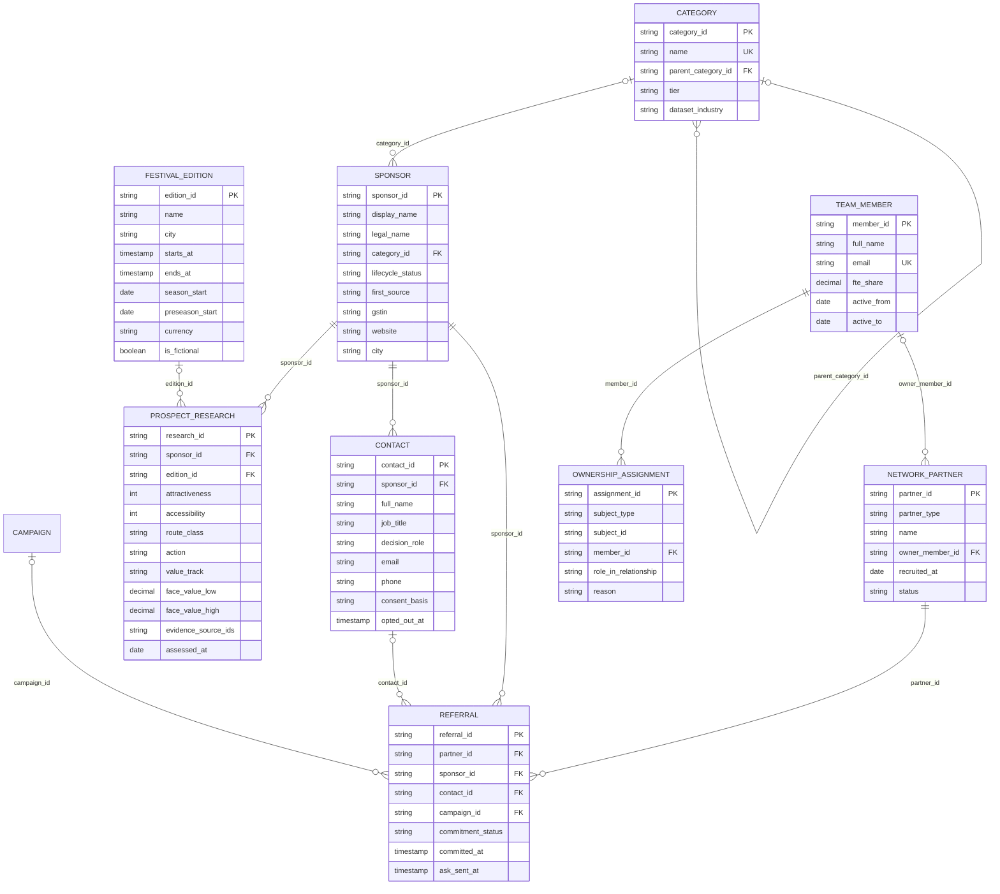
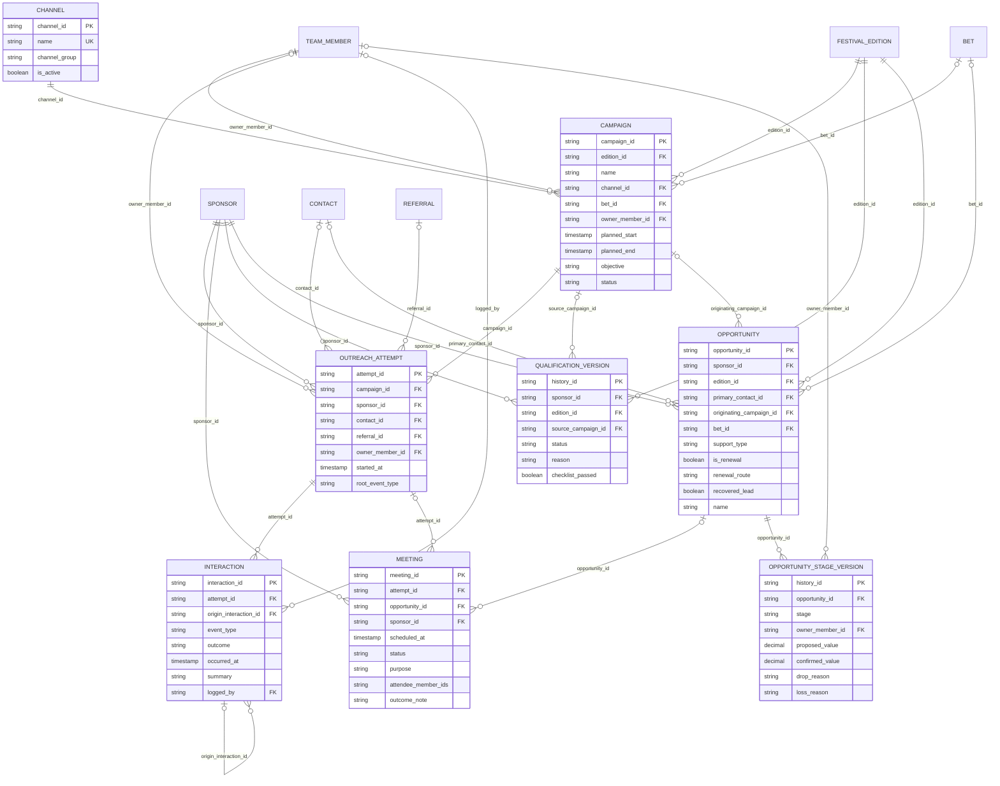
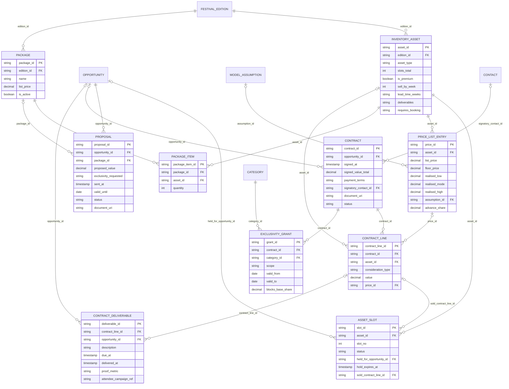
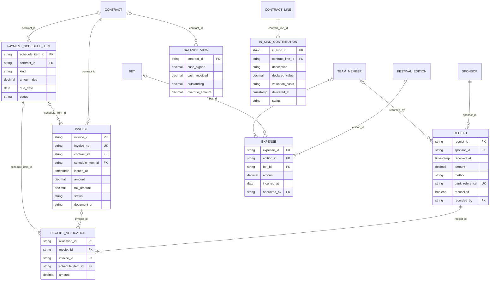
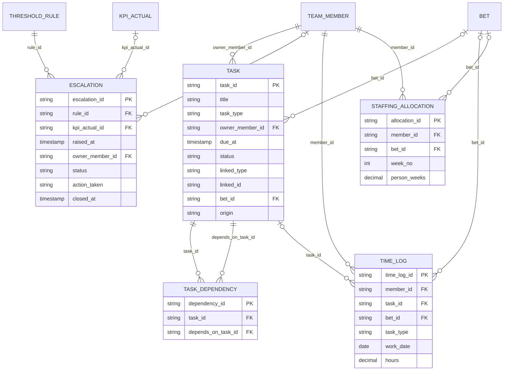
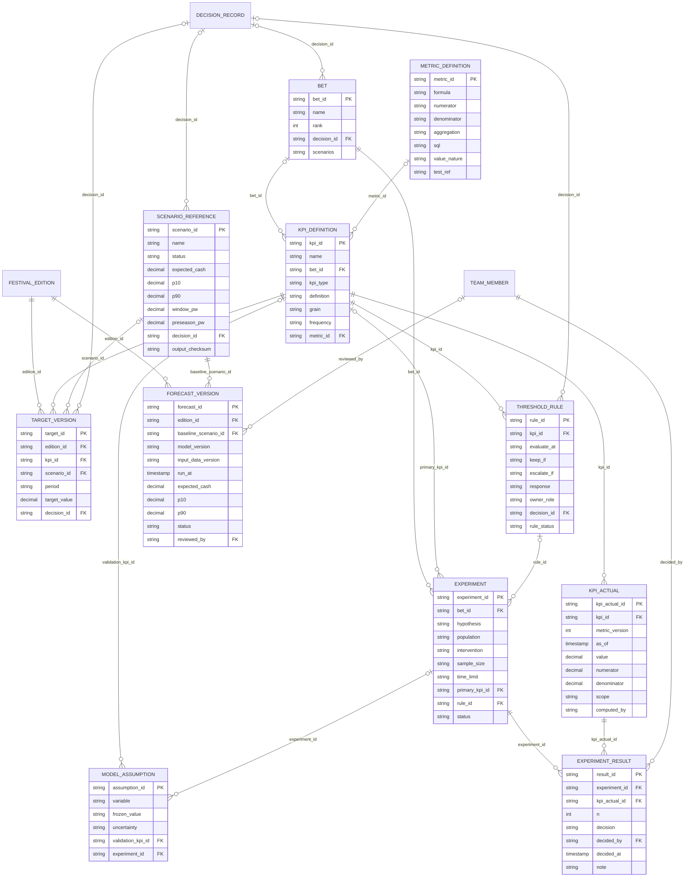
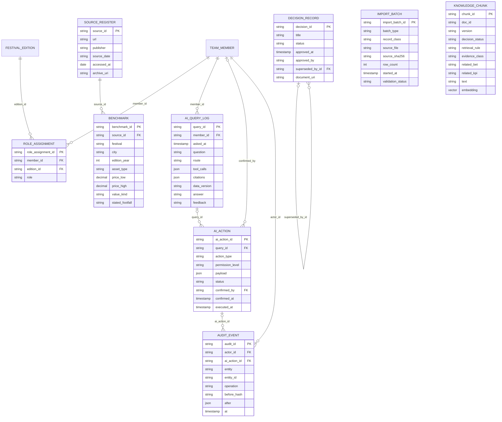

# Conceptual data model for the Growth Center

Phase 6 · version 1.0 · 2026-11-26 · **status: proposed conceptual design** (input to the Stage 8 product blueprint; not a schema, not an implementation, not approved).

Generated from `build/model_spec.py` by `build/build_data_model.py`, which also checks the model against the KPI dictionary, the metric dictionary and the 2025 database. Machine-readable versions: `data_model/entity_catalogue.csv` (59 entities), `data_model/attribute_catalogue.csv`, `data_model/lineage_2025.csv`, `data_model/kpi_entity_coverage.csv`. Full ER diagram: `data_model/er_diagram.svg` (zoomable) and `.png`.

## 1. Design principles

1. **The model extends the 2025 dataset, it does not replace it.** Every staging relation in `sponsor.duckdb` maps to a conceptual entity (section 6); the full-state versioning the dataset already uses for qualification and deal stage is kept and extended to targets, prices, rules and ownership.
2. **Cash exists only as a receipt.** Signed value lives in `CONTRACT_LINE` (cash and in-kind lines kept apart), money owed in `PAYMENT_SCHEDULE_ITEM` and `INVOICE`, money received only in `RECEIPT`. Outstanding balances are a derived view (metric M-07), never stored or typed. No financial entity accepts historical, researched or modelled records.
3. **Research is not pipeline.** A researched company is a `SPONSOR` with `lifecycle_status = research_target` plus a `PROSPECT_RESEARCH` assessment; it cannot get an `OPPORTUNITY` until an `INTERACTION` with a named `CONTACT` exists. Face values never enter pipeline or forecast totals.
4. **Plans are versioned and cannot move after results.** Targets, threshold rules, prices, KPI and metric definitions are full-state versions; a new version may only take effect in the future.
5. **The model never edits the approved baseline.** `SCENARIO_REFERENCE` is a checksum-verified, read-only load of the scenario catalogue; in-season re-forecasts are separate `FORECAST_VERSION` rows created by a job and published after review.
6. **Every write is attributable.** Each stored row carries the provenance block below; every write produces an `AUDIT_EVENT`; writes made through the AI carry the `AI_ACTION` that a named person confirmed.
7. **Measure what the strategy needs.** Fields missing in 2025 that D-010 depends on are first-class here: drop reason, recovered-lead flag, lead-to-bet tag, renewal route, decision role of a contact, commitment status of an introduction, hours, staffing and spend.

## 2. Record classes and separation

The seven record classes come from `02_DATA_FOUNDATION/data_dictionary/provenance_framework.md` (Phase 4). The model separates them in three ways at once, so no single safeguard is load-bearing:

| Layer | Mechanism |
|---|---|
| Environment | Live records exist only in the production operational database. Simulated (demo and test) records exist only in a separate demo environment, loaded by `IMPORT_BATCH` of type `simulation` and deletable as a batch. The 2025 dataset, research registers and model outputs stay in the analytical store (today `sponsor.duckdb` and the repository files) and are loaded into the operational database only as read-only reference tables where the app needs them |
| Row | Every stored row carries `record_class`, constrained per entity (table below). Example: `RECEIPT.record_class ∈ {live, simulated}` |
| Query | Metrics and the AI read class-filtered views; a metric that combines classes (e.g. 2025 vs live funnel) returns them as separate series, never one total. The AI cites `record_class`, `source_ref` and `data_version` with every number |

| Record class | Meaning | Allowed in entities |
|---|---|---|
| `historical_synthetic` | Fictional CampusFest 2025 assignment data | `FESTIVAL_EDITION`, `SPONSOR`, `CONTACT`, `TEAM_MEMBER`, `OWNERSHIP_ASSIGNMENT`, `CAMPAIGN`, `OUTREACH_ATTEMPT`, `INTERACTION`, `MEETING`, `QUALIFICATION_VERSION`, `OPPORTUNITY`, `OPPORTUNITY_STAGE_VERSION`, `CONTRACT_DELIVERABLE`, `TARGET_VERSION`, `KPI_ACTUAL`, `IMPORT_BATCH`, `KNOWLEDGE_CHUNK` |
| `external_research` | Sourced web research (benchmarks, prospects, sources) | `SPONSOR`, `PROSPECT_RESEARCH`, `IMPORT_BATCH`, `SOURCE_REGISTER`, `BENCHMARK`, `KNOWLEDGE_CHUNK` |
| `model_assumption` | Frozen v4.1 judgement inputs | `MODEL_ASSUMPTION`, `IMPORT_BATCH`, `KNOWLEDGE_CHUNK` |
| `model_output` | Frozen model results and in-season re-forecasts | `SCENARIO_REFERENCE`, `FORECAST_VERSION`, `IMPORT_BATCH`, `KNOWLEDGE_CHUNK` |
| `operating_plan` | Approved D-010 plan, rules, definitions, reference data | `CATEGORY`, `CHANNEL`, `INVENTORY_ASSET`, `PRICE_LIST_ENTRY`, `PACKAGE`, `PACKAGE_ITEM`, `BET`, `KPI_DEFINITION`, `METRIC_DEFINITION`, `TARGET_VERSION`, `THRESHOLD_RULE`, `EXPERIMENT`, `DECISION_RECORD`, `IMPORT_BATCH`, `KNOWLEDGE_CHUNK` |
| `live` | Real records entered in season | `FESTIVAL_EDITION`, `SPONSOR`, `CONTACT`, `NETWORK_PARTNER`, `REFERRAL`, `TEAM_MEMBER`, `OWNERSHIP_ASSIGNMENT`, `CAMPAIGN`, `OUTREACH_ATTEMPT`, `INTERACTION`, `MEETING`, `QUALIFICATION_VERSION`, `OPPORTUNITY`, `OPPORTUNITY_STAGE_VERSION`, `ASSET_SLOT`, `PROPOSAL`, `CONTRACT`, `CONTRACT_LINE`, `EXCLUSIVITY_GRANT`, `CONTRACT_DELIVERABLE`, `PAYMENT_SCHEDULE_ITEM`, `INVOICE`, `RECEIPT`, `RECEIPT_ALLOCATION`, `BALANCE_VIEW`, `IN_KIND_CONTRIBUTION`, `EXPENSE`, `TASK`, `TASK_DEPENDENCY`, `ESCALATION`, `TIME_LOG`, `STAFFING_ALLOCATION`, `KPI_ACTUAL`, `EXPERIMENT_RESULT`, `ROLE_ASSIGNMENT`, `IMPORT_BATCH`, `AI_QUERY_LOG`, `AI_ACTION`, `AUDIT_EVENT` |
| `simulated` | Demo and test data | `FESTIVAL_EDITION`, `SPONSOR`, `CONTACT`, `NETWORK_PARTNER`, `REFERRAL`, `TEAM_MEMBER`, `OWNERSHIP_ASSIGNMENT`, `CAMPAIGN`, `OUTREACH_ATTEMPT`, `INTERACTION`, `MEETING`, `QUALIFICATION_VERSION`, `OPPORTUNITY`, `OPPORTUNITY_STAGE_VERSION`, `ASSET_SLOT`, `PROPOSAL`, `CONTRACT`, `CONTRACT_LINE`, `EXCLUSIVITY_GRANT`, `CONTRACT_DELIVERABLE`, `PAYMENT_SCHEDULE_ITEM`, `INVOICE`, `RECEIPT`, `RECEIPT_ALLOCATION`, `BALANCE_VIEW`, `IN_KIND_CONTRIBUTION`, `EXPENSE`, `TASK`, `TASK_DEPENDENCY`, `ESCALATION`, `TIME_LOG`, `STAFFING_ALLOCATION`, `KPI_ACTUAL`, `EXPERIMENT_RESULT`, `FORECAST_VERSION`, `ROLE_ASSIGNMENT`, `IMPORT_BATCH`, `AI_QUERY_LOG`, `AI_ACTION`, `AUDIT_EVENT` |

### Standard provenance block (on every stored entity)

| Field | Type | Meaning |
|---|---|---|
| `record_class` | enum | One of the seven classes; constrained per entity (allowed_record_classes) |
| `import_batch_id` | id | Batch that created the row (UI session, import, model run, simulation run) |
| `source_ref` | text | Pointer to the exact origin (file#sheet!row, SRC-id, model output row, UI form) |
| `evidence_class` | enum | D, B, A, C, T or U |
| `data_version` | text | Dataset or model version the row was derived from, e.g. sponsor.duckdb@42af2e03 |
| `created_at` | timestamptz |  |
| `created_by` | id | Team member or process (never "AI" alone: AI writes carry ai_action_id) |
| `ai_action_id` | id | Set when the row was written through a confirmed AI action |
| `is_deleted` | bool | Soft delete only; history is never removed |

Entities marked *full-state versions* also carry: `valid_from`, `valid_to`, `version_no`, `superseded_by`. *Append-only* entities are never updated; *immutable* entities are written once by a controlled load.

## 3. Entity map

*Figure 1. All 59 entities by domain with primary and foreign keys. Crow's foot marks the "many" side; dashed lines are optional relationships; links to the four hub entities (TEAM_MEMBER, FESTIVAL_EDITION, BET, DECISION_RECORD) appear only as key rows inside the boxes; the footer of each box shows its allowed record classes. Zoomable version: `data_model/er_diagram.svg`.*

| Domain | Entities |
|---|---|
| A. Organisation and relationship management | `FESTIVAL_EDITION`, `CATEGORY`, `SPONSOR`, `CONTACT`, `PROSPECT_RESEARCH`, `NETWORK_PARTNER`, `REFERRAL`, `TEAM_MEMBER`, `OWNERSHIP_ASSIGNMENT` |
| B. Acquisition and campaign management | `CHANNEL`, `CAMPAIGN`, `OUTREACH_ATTEMPT`, `INTERACTION`, `MEETING`, `QUALIFICATION_VERSION`, `OPPORTUNITY`, `OPPORTUNITY_STAGE_VERSION` |
| C. Sponsorship commercial management | `INVENTORY_ASSET`, `ASSET_SLOT`, `PRICE_LIST_ENTRY`, `PACKAGE`, `PACKAGE_ITEM`, `PROPOSAL`, `CONTRACT`, `CONTRACT_LINE`, `EXCLUSIVITY_GRANT`, `CONTRACT_DELIVERABLE` |
| D. Financial management | `PAYMENT_SCHEDULE_ITEM`, `INVOICE`, `RECEIPT`, `RECEIPT_ALLOCATION`, `BALANCE_VIEW`, `IN_KIND_CONTRIBUTION`, `EXPENSE` |
| E. Execution management | `TASK`, `TASK_DEPENDENCY`, `ESCALATION`, `TIME_LOG`, `STAFFING_ALLOCATION` |
| F. Analytics and experimentation | `BET`, `KPI_DEFINITION`, `METRIC_DEFINITION`, `TARGET_VERSION`, `THRESHOLD_RULE`, `KPI_ACTUAL`, `MODEL_ASSUMPTION`, `EXPERIMENT`, `EXPERIMENT_RESULT`, `SCENARIO_REFERENCE`, `FORECAST_VERSION` |
| G. Governance, research and AI | `DECISION_RECORD`, `ROLE_ASSIGNMENT`, `IMPORT_BATCH`, `SOURCE_REGISTER`, `BENCHMARK`, `KNOWLEDGE_CHUNK`, `AI_QUERY_LOG`, `AI_ACTION`, `AUDIT_EVENT` |

### Brief coverage

Every item the brief lists (Part E §6) maps to an entity:

| Brief item | Entity |
|---|---|
| Sponsors | `SPONSOR` |
| Contacts | `CONTACT` |
| Categories | `CATEGORY` |
| Prospects | `PROSPECT_RESEARCH` |
| Referrals | `NETWORK_PARTNER`, `REFERRAL` |
| Relationship owners | `TEAM_MEMBER`, `OWNERSHIP_ASSIGNMENT` |
| Campaigns | `CAMPAIGN` |
| Channels | `CHANNEL` |
| Outreach attempts | `OUTREACH_ATTEMPT` |
| Interactions | `INTERACTION` |
| Meetings | `MEETING` |
| Qualification | `QUALIFICATION_VERSION` |
| Opportunities | `OPPORTUNITY` |
| Inventory assets | `INVENTORY_ASSET` |
| Packages | `PACKAGE`, `PACKAGE_ITEM` |
| Slot availability | `ASSET_SLOT` |
| Pricing | `PRICE_LIST_ENTRY` |
| Exclusivity | `EXCLUSIVITY_GRANT` |
| Proposals | `PROPOSAL` |
| Contracts | `CONTRACT` |
| Deal status | `OPPORTUNITY_STAGE_VERSION` |
| Signed values | `CONTRACT`, `CONTRACT_LINE` |
| Invoices | `INVOICE` |
| Payment schedules | `PAYMENT_SCHEDULE_ITEM` |
| Advance due | `PAYMENT_SCHEDULE_ITEM` |
| Balances | `RECEIPT_ALLOCATION`, `BALANCE_VIEW` |
| Receipts | `RECEIPT` |
| In-kind contributions | `IN_KIND_CONTRIBUTION` |
| Tasks | `TASK` |
| Owners | `TEAM_MEMBER`, `TASK` |
| Deadlines | `TASK` |
| Dependencies | `TASK_DEPENDENCY` |
| Status | `TASK` |
| Escalations | `ESCALATION` |
| KPI definitions | `KPI_DEFINITION`, `METRIC_DEFINITION` |
| Targets | `TARGET_VERSION` |
| Actuals | `KPI_ACTUAL` |
| Experiments | `EXPERIMENT` |
| Results | `EXPERIMENT_RESULT` |
| Forecast versions | `FORECAST_VERSION` |
| Scenario references | `SCENARIO_REFERENCE` |

## 4. Entities by domain

### A. Organisation and relationship management

*Figure A. Organisation and relationship management. Entities from other domains shown by name only: CAMPAIGN.*

#### FESTIVAL_EDITION

**Purpose.** One edition of the festival; scopes targets, inventory, scenarios and every season record.

**Primary key.** `edition_id` · **Versioning:** mutable with audit · **Allowed record classes:** historical_synthetic, live, simulated

| Attribute | Type | Key | Notes |
|---|---|---|---|
| `edition_id` | id | PK |  |
| `name` | text | required |  |
| `city` | text |  |  |
| `starts_at` | timestamptz | required | Cut-off for "before the fest" metrics |
| `ends_at` | timestamptz | required |  |
| `season_start` | date |  | W1 day 1 |
| `preseason_start` | date |  | W−5 |
| `currency` | text | required | INR |
| `is_fictional` | bool | required |  |

**Relationships.** References: none. Referenced by: `PROSPECT_RESEARCH`.`edition_id`; `CAMPAIGN`.`edition_id`; `QUALIFICATION_VERSION`.`edition_id`; `OPPORTUNITY`.`edition_id`; `INVENTORY_ASSET`.`edition_id`; `PACKAGE`.`edition_id`; `EXPENSE`.`edition_id`; `TARGET_VERSION`.`edition_id`; `FORECAST_VERSION`.`edition_id`; `ROLE_ASSIGNMENT`.`edition_id`.

**Constraints.** Exactly one edition is "current" at a time · starts_at > season_start; T−7 = starts_at − 7 days drives the cash gate · is_fictional = true for the 2025 assignment edition; such an edition can never be current

**Provenance.** Standard block. Edition-level; the 2025 row comes from stg.event with is_fictional = true.

**Example** (synthetic 2025 record (assignment dataset; fictional)): `edition_id` = ED-2025, `name` = CampusFest 2025, `starts_at` = 2025-04-12 10:00 IST, `is_fictional` = true, `record_class` = historical_synthetic

#### CATEGORY

**Purpose.** Sponsor category used for targeting, exclusivity and premium-asset limits (one premium asset per category).

**Primary key.** `category_id` · **Versioning:** mutable with audit · **Allowed record classes:** operating_plan

| Attribute | Type | Key | Notes |
|---|---|---|---|
| `category_id` | id | PK |  |
| `name` | text | unique | e.g. Consumer fintech |
| `parent_category_id` | id | FK → `CATEGORY` | Optional hierarchy for narrow exclusivity, e.g. payments within fintech |
| `tier` | enum |  | T1 / T2 / selective (D-008) |
| `dataset_industry` | text |  | Mapping to the 2025 industry values |

**Relationships.** References: `parent_category_id` → `CATEGORY`. Referenced by: `SPONSOR`.`category_id`; `EXCLUSIVITY_GRANT`.`category_id`.

**Constraints.** Names unique within a parent · Exclusivity is granted on a category node; narrow = a child node

**Provenance.** Standard block. Reference data; changes versioned and approved.

**Example** (approved operating-plan record (D-010)): `category_id` = CAT-FIN, `name` = Consumer fintech, `tier` = T1

#### SPONSOR

**Purpose.** An organisation that is, was or may become a sponsor (the 2025 "brand").

**Primary key.** `sponsor_id` · **Versioning:** mutable with audit · **Allowed record classes:** historical_synthetic, external_research, live, simulated

| Attribute | Type | Key | Notes |
|---|---|---|---|
| `sponsor_id` | id | PK |  |
| `display_name` | text | required |  |
| `legal_name` | text |  | Needed for invoices |
| `category_id` | id | FK → `CATEGORY` |  |
| `lifecycle_status` | enum | required | research_target / prospect / active / past_sponsor / do_not_contact |
| `first_source` | enum |  | research, referral, inbound, outreach, renewal |
| `gstin` | text |  | Tax ID for invoicing; restricted field |
| `website` | text |  |  |
| `city` | text |  |  |

**Relationships.** References: `category_id` → `CATEGORY`. Referenced by: `CONTACT`.`sponsor_id`; `PROSPECT_RESEARCH`.`sponsor_id`; `REFERRAL`.`sponsor_id`; `OUTREACH_ATTEMPT`.`sponsor_id`; `MEETING`.`sponsor_id`; `QUALIFICATION_VERSION`.`sponsor_id`; `OPPORTUNITY`.`sponsor_id`; `RECEIPT`.`sponsor_id`.

**Constraints.** Normalised display_name unique per edition-independent registry (duplicate check before insert) · lifecycle_status = research_target until an INTERACTION with a named CONTACT exists (provenance rule 4) · past_sponsor set only from a CONTRACT in an earlier edition

**Provenance.** Standard block. Mixed classes in one registry: each row carries record_class; 2025 brands are historical_synthetic and never merge with live sponsors of the same name.

**Example** (synthetic 2025 record (assignment dataset; fictional)): `sponsor_id` = A027, `display_name` = Cedar Pantry, `category (2025 industry)` = Consumer products, `lifecycle_status` = prospect, `record_class` = historical_synthetic

#### CONTACT

**Purpose.** A person at a sponsor.

**Primary key.** `contact_id` · **Versioning:** mutable with audit · **Allowed record classes:** historical_synthetic, live, simulated

| Attribute | Type | Key | Notes |
|---|---|---|---|
| `contact_id` | id | PK |  |
| `sponsor_id` | id | FK → `SPONSOR` | required |
| `full_name` | text | required | Personal data |
| `job_title` | text |  |  |
| `decision_role` | enum |  | decision_maker / influencer / user / unknown (absent in 2025 data) |
| `email` | text |  | Personal data |
| `phone` | text |  | Personal data |
| `consent_basis` | enum |  | How contact details were obtained |
| `opted_out_at` | timestamptz |  |  |

**Relationships.** References: `sponsor_id` → `SPONSOR`. Referenced by: `REFERRAL`.`contact_id`; `OUTREACH_ATTEMPT`.`contact_id`; `OPPORTUNITY`.`primary_contact_id`; `CONTRACT`.`signatory_contact_id`.

**Constraints.** A contact belongs to exactly one sponsor · decision_role defaults to unknown; the AI must not infer it from job_title · opted_out contacts cannot receive outreach (blocking rule on OUTREACH_ATTEMPT)

**Provenance.** Standard block. Personal data: restricted read; source of every contact detail recorded in source_ref.

**Example** (synthetic 2025 record (assignment dataset; fictional)): `contact_id` = SCON054, `sponsor_id` = A027, `full_name` = Zoya Gupta, `job_title` = Brand Marketing Lead, `decision_role` = unknown

#### PROSPECT_RESEARCH

**Purpose.** Research assessment of a sponsor not yet in conversation (the W-001 prospect register).

**Primary key.** `research_id` · **Versioning:** full-state versions · **Allowed record classes:** external_research

| Attribute | Type | Key | Notes |
|---|---|---|---|
| `research_id` | id | PK |  |
| `sponsor_id` | id | FK → `SPONSOR` | required |
| `edition_id` | id | FK → `FESTIVAL_EDITION` |  |
| `attractiveness` | int |  | 0–100 |
| `accessibility` | int |  | 0–100 |
| `route_class` | enum |  | A, V1, V2, V3, U_local, U, U_out |
| `action` | enum |  | Pursue now / Build a route / Opportunistic / Deprioritise |
| `value_track` | enum |  | cash / in_kind |
| `face_value_low` | money |  | Research estimate, never a forecast |
| `face_value_high` | money |  |  |
| `evidence_source_ids` | text |  | SRC-ids |
| `assessed_at` | date | required |  |

**Relationships.** References: `sponsor_id` → `SPONSOR`; `edition_id` → `FESTIVAL_EDITION`. Referenced by: none.

**Constraints.** Never counted in pipeline or forecast totals · route_class A (actual introduction) requires a linked REFERRAL with commitment_status = committed · A new assessment supersedes the old one (versioned)

**Provenance.** Standard block. Always external_research; every score cites SRC-ids.

**Example** (external research record (real company or festival; research only)): `research_id` = PR-001, `sponsor` = Zerodha, `route_class` = V1, `action` = 1 Pursue now, `attractiveness` = 94, `accessibility` = 70

#### NETWORK_PARTNER

**Purpose.** A person or organisation that refers sponsors: creator, VC fund, alumnus, past sponsor.

**Primary key.** `partner_id` · **Versioning:** mutable with audit · **Allowed record classes:** live, simulated

| Attribute | Type | Key | Notes |
|---|---|---|---|
| `partner_id` | id | PK |  |
| `partner_type` | enum | required | creator / vc_fund / alumnus / past_sponsor / other |
| `name` | text | required |  |
| `owner_member_id` | id | FK → `TEAM_MEMBER` | Relationship owner (community or network role) |
| `recruited_at` | date |  | K-B4b-01 |
| `status` | enum |  | invited / active / inactive |

**Relationships.** References: `owner_member_id` → `TEAM_MEMBER`. Referenced by: `REFERRAL`.`partner_id`.

**Constraints.** Recruited creators counted by recruited_at within the season (K-B4b-01)

**Provenance.** Standard block. Live only; no 2025 equivalent beyond campaign names.

**Example** (illustrative live record (invented for this document; no such record exists)): `partner_id` = NP-014, `partner_type` = creator, `name` = (creator name), `status` = active

#### REFERRAL

**Purpose.** An introduction or referral of a sponsor contact by a network partner (B3 introductions, B4b creator referrals, sponsor referrals).

**Primary key.** `referral_id` · **Versioning:** full-state versions · **Allowed record classes:** live, simulated

| Attribute | Type | Key | Notes |
|---|---|---|---|
| `referral_id` | id | PK |  |
| `partner_id` | id | FK → `NETWORK_PARTNER` | required |
| `sponsor_id` | id | FK → `SPONSOR` | required |
| `contact_id` | id | FK → `CONTACT` | Named decision-maker |
| `campaign_id` | id | FK → `CAMPAIGN` |  |
| `commitment_status` | enum | required | speculative / committed / met / declined / lapsed |
| `committed_at` | timestamptz |  | K-B3-02 counts committed at W2 |
| `ask_sent_at` | timestamptz |  | K-B3-01 |

**Relationships.** References: `partner_id` → `NETWORK_PARTNER`; `sponsor_id` → `SPONSOR`; `contact_id` → `CONTACT`; `campaign_id` → `CAMPAIGN`. Referenced by: `OUTREACH_ATTEMPT`.`referral_id`.

**Constraints.** committed requires a named contact_id and an agreed meeting (D-010 definition) · Only committed referrals count toward the ≥ 6 introductions rule · A referral never implies an opportunity; the opportunity is created after qualification

**Provenance.** Standard block. Live only. D-010 records 0 committed introductions today; nothing may be back-filled without a source.

**Example** (illustrative live record (invented for this document; no such record exists)): `referral_id` = RF-003, `partner_type` = vc_fund, `commitment_status` = speculative, `contact_id` = —

#### TEAM_MEMBER

**Purpose.** A festival team member: relationship owner, task owner, system user.

**Primary key.** `member_id` · **Versioning:** mutable with audit · **Allowed record classes:** historical_synthetic, live, simulated

| Attribute | Type | Key | Notes |
|---|---|---|---|
| `member_id` | id | PK |  |
| `full_name` | text | required |  |
| `email` | text | unique | Login identity |
| `fte_share` | decimal |  | Half-time student = 0.5 |
| `active_from` | date |  |  |
| `active_to` | date |  |  |

**Relationships.** References: none. Referenced by: `NETWORK_PARTNER`.`owner_member_id`; `OWNERSHIP_ASSIGNMENT`.`member_id`; `CAMPAIGN`.`owner_member_id`; `OUTREACH_ATTEMPT`.`owner_member_id`; `INTERACTION`.`logged_by`; `OPPORTUNITY_STAGE_VERSION`.`owner_member_id`; `RECEIPT`.`recorded_by`; `EXPENSE`.`approved_by`; `TASK`.`owner_member_id`; `ESCALATION`.`owner_member_id`; `TIME_LOG`.`member_id`; `STAFFING_ALLOCATION`.`member_id`; `EXPERIMENT_RESULT`.`decided_by`; `FORECAST_VERSION`.`reviewed_by`; `ROLE_ASSIGNMENT`.`member_id`; `AI_QUERY_LOG`.`member_id`; `AI_ACTION`.`confirmed_by`; `AUDIT_EVENT`.`actor_id`.

**Constraints.** Roles are assigned in ROLE_ASSIGNMENT, never stored here · Deactivated members keep their history

**Provenance.** Standard block. 2025 owners (T01, T02, T05) are historical_synthetic and are not user accounts.

**Example** (synthetic 2025 record (assignment dataset; fictional)): `member_id` = T01, `full_name` = Riya Kapoor, `record_class` = historical_synthetic

#### OWNERSHIP_ASSIGNMENT

**Purpose.** Who owns a sponsor relationship or opportunity over time (handoffs are the 2025 leak point).

**Primary key.** `assignment_id` · **Versioning:** full-state versions · **Allowed record classes:** historical_synthetic, live, simulated

| Attribute | Type | Key | Notes |
|---|---|---|---|
| `assignment_id` | id | PK |  |
| `subject_type` | enum | required | sponsor / opportunity / network_partner |
| `subject_id` | id | required | Polymorphic link |
| `member_id` | id | FK → `TEAM_MEMBER` | required |
| `role_in_relationship` | enum |  | owner / support |
| `reason` | text |  | handoff reason |

**Relationships.** References: `member_id` → `TEAM_MEMBER`. Referenced by: none.

**Constraints.** At most one current owner per subject · A handoff closes the old assignment and opens a new one in the same transaction

**Provenance.** Standard block. Versioned so time-to-handoff and owner load can be measured.

**Example** (synthetic 2025 record (assignment dataset; fictional)): `subject` = opportunity O028, `member_id` = T01, `valid_from` = 2025-03-09

### B. Acquisition and campaign management

*Figure B. Acquisition and campaign management. Entities from other domains shown by name only: BET, CONTACT, FESTIVAL_EDITION, REFERRAL, SPONSOR, TEAM_MEMBER.*

#### CHANNEL

**Purpose.** Reference list of acquisition channels and their group (warm / inbound / cold / renewal / premium).

**Primary key.** `channel_id` · **Versioning:** mutable with audit · **Allowed record classes:** operating_plan

| Attribute | Type | Key | Notes |
|---|---|---|---|
| `channel_id` | id | PK |  |
| `name` | text | unique | email, linkedin, introduction, web_inbound, creator_referral, renewal, premium_pitch |
| `channel_group` | enum | required | warm / inbound / cold / renewal / premium |
| `is_active` | bool | required | Cold-only channels inactive from W1 day 1 (D-010) |

**Relationships.** References: none. Referenced by: `CAMPAIGN`.`channel_id`.

**Constraints.** channel_group drives every channel KPI; changing it is a versioned decision

**Provenance.** Standard block. Reference data.

**Example** (approved operating-plan record (D-010)): `channel_id` = CH-INTRO, `name` = introduction, `channel_group` = warm

#### CAMPAIGN

**Purpose.** A planned acquisition effort with a channel, owner, window and bet.

**Primary key.** `campaign_id` · **Versioning:** mutable with audit · **Allowed record classes:** historical_synthetic, live, simulated

| Attribute | Type | Key | Notes |
|---|---|---|---|
| `campaign_id` | id | PK |  |
| `edition_id` | id | FK → `FESTIVAL_EDITION` | required |
| `name` | text | required |  |
| `channel_id` | id | FK → `CHANNEL` | required |
| `bet_id` | id | FK → `BET` | Which D-010 bet it serves |
| `owner_member_id` | id | FK → `TEAM_MEMBER` |  |
| `planned_start` | timestamptz |  |  |
| `planned_end` | timestamptz |  |  |
| `objective` | text |  |  |
| `status` | enum |  | planned / active / stopped / closed |

**Relationships.** References: `edition_id` → `FESTIVAL_EDITION`; `channel_id` → `CHANNEL`; `bet_id` → `BET`; `owner_member_id` → `TEAM_MEMBER`. Referenced by: `REFERRAL`.`campaign_id`; `OUTREACH_ATTEMPT`.`campaign_id`; `QUALIFICATION_VERSION`.`source_campaign_id`; `OPPORTUNITY`.`originating_campaign_id`.

**Constraints.** A campaign on an inactive (cold-only) channel cannot be activated without a recorded decision · Every outreach attempt belongs to exactly one campaign

**Provenance.** Standard block. 2025 campaigns SC01–SC06 are historical_synthetic.

**Example** (synthetic 2025 record (assignment dataset; fictional)): `campaign_id` = SC05, `name` = Creator Network Referrals, `channel` = introduction, `channel_group` = warm

#### OUTREACH_ATTEMPT

**Purpose.** One root touch to a contact (outreach sent, introduction received, inbound form) and its follow-on events.

**Primary key.** `attempt_id` · **Versioning:** append-only · **Allowed record classes:** historical_synthetic, live, simulated

| Attribute | Type | Key | Notes |
|---|---|---|---|
| `attempt_id` | id | PK |  |
| `campaign_id` | id | FK → `CAMPAIGN` | required |
| `sponsor_id` | id | FK → `SPONSOR` | required |
| `contact_id` | id | FK → `CONTACT` |  |
| `referral_id` | id | FK → `REFERRAL` | Set for introductions |
| `owner_member_id` | id | FK → `TEAM_MEMBER` |  |
| `started_at` | timestamptz | required |  |
| `root_event_type` | enum | required | outreach_sent / introduction_received / web_inbound |

**Relationships.** References: `campaign_id` → `CAMPAIGN`; `sponsor_id` → `SPONSOR`; `contact_id` → `CONTACT`; `referral_id` → `REFERRAL`; `owner_member_id` → `TEAM_MEMBER`. Referenced by: `INTERACTION`.`attempt_id`; `MEETING`.`attempt_id`.

**Constraints.** Blocked if contact opted out · Derived flags (delivered, replied, meeting booked/held) are computed from INTERACTION, not stored

**Provenance.** Standard block. Attempts ≠ contacts ≠ sponsors: grain stated with every rate.

**Example** (synthetic 2025 record (assignment dataset; fictional)): `attempt_id` = SA0037, `sponsor_id` = A027, `campaign_id` = SC03, `root_event_type` = outreach_sent

#### INTERACTION

**Purpose.** An event in an attempt: delivered, replied, meeting booked or held, opted out, note.

**Primary key.** `interaction_id` · **Versioning:** append-only · **Allowed record classes:** historical_synthetic, live, simulated

| Attribute | Type | Key | Notes |
|---|---|---|---|
| `interaction_id` | id | PK |  |
| `attempt_id` | id | FK → `OUTREACH_ATTEMPT` | required |
| `origin_interaction_id` | id | FK → `INTERACTION` | Root event |
| `event_type` | enum | required |  |
| `outcome` | enum |  |  |
| `occurred_at` | timestamptz | required |  |
| `summary` | text |  | Commercial content; restricted |
| `logged_by` | id | FK → `TEAM_MEMBER` |  |

**Relationships.** References: `attempt_id` → `OUTREACH_ATTEMPT`; `origin_interaction_id` → `INTERACTION`; `logged_by` → `TEAM_MEMBER`. Referenced by: none.

**Constraints.** Append-only; corrections are new events · Exact duplicates rejected on (attempt_id, event_type, occurred_at) · Events at or after festival start excluded from pre-fest metrics

**Provenance.** Standard block. Import retries detected by the duplicate rule (2025 had 3).

**Example** (synthetic 2025 record (assignment dataset; fictional)): `interaction_id` = SI00133, `attempt_id` = SA0037, `event_type` = outreach_sent, `occurred_at` = 2025-03-03 10:00 IST

#### MEETING

**Purpose.** A scheduled or held meeting with a sponsor (in 2025 only an event type; a first-class record live).

**Primary key.** `meeting_id` · **Versioning:** mutable with audit · **Allowed record classes:** historical_synthetic, live, simulated

| Attribute | Type | Key | Notes |
|---|---|---|---|
| `meeting_id` | id | PK |  |
| `attempt_id` | id | FK → `OUTREACH_ATTEMPT` |  |
| `opportunity_id` | id | FK → `OPPORTUNITY` |  |
| `sponsor_id` | id | FK → `SPONSOR` | required |
| `scheduled_at` | timestamptz | required |  |
| `status` | enum | required | booked / held / no_show / cancelled |
| `purpose` | enum |  | discovery / renewal_screen / title_pitch / negotiation |
| `attendee_member_ids` | id[] |  |  |
| `outcome_note` | text |  |  |

**Relationships.** References: `attempt_id` → `OUTREACH_ATTEMPT`; `opportunity_id` → `OPPORTUNITY`; `sponsor_id` → `SPONSOR`. Referenced by: none.

**Constraints.** held requires scheduled_at ≤ now · A renewal screening call is a MEETING with purpose renewal_screen (K-B4a-01)

**Provenance.** Standard block. 2025 meetings are derived from meeting_booked / meeting_held interactions.

**Example** (synthetic 2025 record (assignment dataset; fictional)): `meeting_id` = from SI00003, `sponsor_id` = A001, `status` = booked, `scheduled_at` = 2025-03-05 14:00 IST

#### QUALIFICATION_VERSION

**Purpose.** Full-state qualification status of a sponsor (unreviewed, engaged, qualified, unqualified, dormant).

**Primary key.** `history_id` · **Versioning:** full-state versions · **Allowed record classes:** historical_synthetic, live, simulated

| Attribute | Type | Key | Notes |
|---|---|---|---|
| `history_id` | id | PK |  |
| `sponsor_id` | id | FK → `SPONSOR` | required |
| `edition_id` | id | FK → `FESTIVAL_EDITION` | required |
| `source_campaign_id` | id | FK → `CAMPAIGN` |  |
| `status` | enum | required |  |
| `reason` | text |  |  |
| `checklist_passed` | bool |  | Qualification checklist (B1) |

**Relationships.** References: `sponsor_id` → `SPONSOR`; `edition_id` → `FESTIVAL_EDITION`; `source_campaign_id` → `CAMPAIGN`. Referenced by: none.

**Constraints.** Latest version on or before D applies; never sum versions · qualified starts the B1 SLA clock (deal ≤ 5 days, proposal ≤ 10 days)

**Provenance.** Standard block. Full-state versions as in 2025.

**Example** (synthetic 2025 record (assignment dataset; fictional)): `history_id` = BQ0081, `sponsor_id` = A027, `status` = qualified, `valid_from` = 2025-03-04 12:00 IST

#### OPPORTUNITY

**Purpose.** One potential partnership with one sponsor in one edition.

**Primary key.** `opportunity_id` · **Versioning:** mutable with audit · **Allowed record classes:** historical_synthetic, live, simulated

| Attribute | Type | Key | Notes |
|---|---|---|---|
| `opportunity_id` | id | PK |  |
| `sponsor_id` | id | FK → `SPONSOR` | required |
| `edition_id` | id | FK → `FESTIVAL_EDITION` | required |
| `primary_contact_id` | id | FK → `CONTACT` |  |
| `originating_campaign_id` | id | FK → `CAMPAIGN` | Fixed at creation |
| `bet_id` | id | FK → `BET` | Lead-to-bet tag (missing in 2025) |
| `support_type` | enum | required | cash / in_kind / mixed |
| `is_renewal` | bool |  |  |
| `renewal_route` | enum |  | K-B4a-05 route tag (proposed) |
| `recovered_lead` | bool |  | B1 recovered flag (K-B1-03; definition open) |
| `name` | text |  |  |

**Relationships.** References: `sponsor_id` → `SPONSOR`; `edition_id` → `FESTIVAL_EDITION`; `primary_contact_id` → `CONTACT`; `originating_campaign_id` → `CAMPAIGN`; `bet_id` → `BET`. Referenced by: `MEETING`.`opportunity_id`; `OPPORTUNITY_STAGE_VERSION`.`opportunity_id`; `ASSET_SLOT`.`held_for_opportunity_id`; `PROPOSAL`.`opportunity_id`; `CONTRACT`.`opportunity_id`; `CONTRACT_DELIVERABLE`.`opportunity_id`.

**Constraints.** Sponsor must not be research_target (needs a recorded interaction) · originating_campaign_id immutable · Stage and values live in OPPORTUNITY_STAGE_VERSION only

**Provenance.** Standard block. Live opportunities never mix with 2025 rows in pipeline totals.

**Example** (synthetic 2025 record (assignment dataset; fictional)): `opportunity_id` = O028, `sponsor_id` = A027, `originating_campaign_id` = SC03, `support_type` = cash

#### OPPORTUNITY_STAGE_VERSION

**Purpose.** Full-state deal status with proposed and confirmed value (the deal status history).

**Primary key.** `history_id` · **Versioning:** full-state versions · **Allowed record classes:** historical_synthetic, live, simulated

| Attribute | Type | Key | Notes |
|---|---|---|---|
| `history_id` | id | PK |  |
| `opportunity_id` | id | FK → `OPPORTUNITY` | required |
| `stage` | enum | required | prospecting / contacted / proposal_sent / negotiating / partner_confirmed / lost / withdrawn |
| `owner_member_id` | id | FK → `TEAM_MEMBER` |  |
| `proposed_value` | money |  | Face value |
| `confirmed_value` | money |  | Signed value, only at partner_confirmed |
| `drop_reason` | enum |  | Mandatory for lost / withdrawn and for SLA drops (K-B1-05) |
| `loss_reason` | enum |  | incl. terms dispute (K-B2-03) |

**Relationships.** References: `opportunity_id` → `OPPORTUNITY`; `owner_member_id` → `TEAM_MEMBER`. Referenced by: none.

**Constraints.** Append-only full-state versions · confirmed_value > 0 only when stage = partner_confirmed and a CONTRACT exists (live) · lost / withdrawn require drop_reason · confirmed_value is signed value, never cash

**Provenance.** Standard block. 2025 versions are historical_synthetic.

**Example** (synthetic 2025 record (assignment dataset; fictional)): `history_id` = OH00138, `opportunity_id` = O028, `stage` = negotiating, `proposed_value` = 110000, `confirmed_value` = 0

### C. Sponsorship commercial management

*Figure C. Sponsorship commercial management. Entities from other domains shown by name only: CATEGORY, CONTACT, FESTIVAL_EDITION, MODEL_ASSUMPTION, OPPORTUNITY.*

#### INVENTORY_ASSET

**Purpose.** A sellable asset type for an edition (title, presenting, activation, digital, headline night).

**Primary key.** `asset_id` · **Versioning:** mutable with audit · **Allowed record classes:** operating_plan

| Attribute | Type | Key | Notes |
|---|---|---|---|
| `asset_id` | id | PK |  |
| `edition_id` | id | FK → `FESTIVAL_EDITION` | required |
| `asset_type` | enum | required |  |
| `slots_total` | int | required |  |
| `is_premium` | bool | required |  |
| `sell_by_week` | int |  | Title W7 |
| `lead_time_weeks` | text |  | 4–8–14 for title [A] |
| `deliverables` | text |  |  |
| `requires_booking` | text |  | Headline night only if an act is booked |

**Relationships.** References: `edition_id` → `FESTIVAL_EDITION`. Referenced by: `ASSET_SLOT`.`asset_id`; `PRICE_LIST_ENTRY`.`asset_id`; `PACKAGE_ITEM`.`asset_id`; `CONTRACT_LINE`.`asset_id`.

**Constraints.** One premium asset per category per edition · Standalone category exclusives are not an asset (D-010)

**Provenance.** Standard block. Plan record; parameters cite model_assumption rows.

**Example** (approved operating-plan record (D-010)): `asset_id` = INV-TITLE, `asset_type` = title, `slots_total` = 1, `is_premium` = true, `sell_by_week` = 7

#### ASSET_SLOT

**Purpose.** One sellable unit of an asset and its availability.

**Primary key.** `slot_id` · **Versioning:** mutable with audit · **Allowed record classes:** live, simulated

| Attribute | Type | Key | Notes |
|---|---|---|---|
| `slot_id` | id | PK |  |
| `asset_id` | id | FK → `INVENTORY_ASSET` | required |
| `slot_no` | int | required |  |
| `status` | enum | required | available / held / sold / withdrawn |
| `held_for_opportunity_id` | id | FK → `OPPORTUNITY` |  |
| `hold_expires_at` | timestamptz |  |  |
| `sold_contract_line_id` | id | FK → `CONTRACT_LINE` |  |

**Relationships.** References: `asset_id` → `INVENTORY_ASSET`; `held_for_opportunity_id` → `OPPORTUNITY`; `sold_contract_line_id` → `CONTRACT_LINE`. Referenced by: none.

**Constraints.** (asset_id, slot_no) unique · sold requires a contract line; one line per slot · Holds expire automatically; a held slot cannot be held twice (row lock)

**Provenance.** Standard block. Live; status history in AUDIT_EVENT.

**Example** (illustrative live record (invented for this document; no such record exists)): `slot_id` = INV-ACT-07, `asset` = activation, `status` = held, `hold_expires_at` = (date)

#### PRICE_LIST_ENTRY

**Purpose.** Versioned rate card: list price, floor and realised range per asset.

**Primary key.** `price_id` · **Versioning:** full-state versions · **Allowed record classes:** operating_plan

| Attribute | Type | Key | Notes |
|---|---|---|---|
| `price_id` | id | PK |  |
| `asset_id` | id | FK → `INVENTORY_ASSET` | required |
| `list_price` | money |  | Ask |
| `floor_price` | money |  |  |
| `realised_low` | money |  | Model range [A] |
| `realised_mode` | money |  |  |
| `realised_high` | money |  |  |
| `assumption_id` | id | FK → `MODEL_ASSUMPTION` | Evidence for the range |
| `advance_share` | decimal |  | e.g. 0.5 title, 1.0 activation |

**Relationships.** References: `asset_id` → `INVENTORY_ASSET`; `assumption_id` → `MODEL_ASSUMPTION`. Referenced by: `CONTRACT_LINE`.`price_id`.

**Constraints.** Effective versions do not overlap per asset · Discount below floor needs an approval recorded in AUDIT_EVENT

**Provenance.** Standard block. Prices are assumptions on asking-price ratios, labelled A.

**Example** (model record (frozen v4.1) as plan): `asset` = presenting, `realised_low` = ₹1.0L, `realised_mode` = ₹1.6L, `realised_high` = ₹2.6L, `advance_share` = 0.5

#### PACKAGE

**Purpose.** A named bundle offered to sponsors.

**Primary key.** `package_id` · **Versioning:** mutable with audit · **Allowed record classes:** operating_plan

| Attribute | Type | Key | Notes |
|---|---|---|---|
| `package_id` | id | PK |  |
| `edition_id` | id | FK → `FESTIVAL_EDITION` | required |
| `name` | text | required |  |
| `list_price` | money |  |  |
| `is_active` | bool | required |  |

**Relationships.** References: `edition_id` → `FESTIVAL_EDITION`. Referenced by: `PACKAGE_ITEM`.`package_id`; `PROPOSAL`.`package_id`.

**Constraints.** A package price equals the sum of its items unless a discount is recorded

**Provenance.** Standard block. Plan record.

**Example** (illustrative live record (invented for this document; no such record exists)): `package_id` = PKG-DIG-1, `name` = Digital package

#### PACKAGE_ITEM

**Purpose.** An asset inside a package.

**Primary key.** `package_item_id` · **Versioning:** mutable with audit · **Allowed record classes:** operating_plan

| Attribute | Type | Key | Notes |
|---|---|---|---|
| `package_item_id` | id | PK |  |
| `package_id` | id | FK → `PACKAGE` | required |
| `asset_id` | id | FK → `INVENTORY_ASSET` | required |
| `quantity` | int | required |  |

**Relationships.** References: `package_id` → `PACKAGE`; `asset_id` → `INVENTORY_ASSET`. Referenced by: none.

**Constraints.** (package_id, asset_id) unique

**Provenance.** Standard block. Plan record.

**Example** (illustrative live record (invented for this document; no such record exists)): `package_id` = PKG-DIG-1, `asset` = digital, `quantity` = 1

#### PROPOSAL

**Purpose.** A versioned offer sent to a sponsor.

**Primary key.** `proposal_id` · **Versioning:** full-state versions · **Allowed record classes:** live, simulated

| Attribute | Type | Key | Notes |
|---|---|---|---|
| `proposal_id` | id | PK |  |
| `opportunity_id` | id | FK → `OPPORTUNITY` | required |
| `package_id` | id | FK → `PACKAGE` |  |
| `proposed_value` | money | required |  |
| `exclusivity_requested` | enum |  | none / narrow / broad |
| `sent_at` | timestamptz |  | K-B1-02 clock stop |
| `valid_until` | date |  |  |
| `status` | enum | required | draft / sent / superseded / accepted / declined |
| `document_uri` | text |  | Stored file |

**Relationships.** References: `opportunity_id` → `OPPORTUNITY`; `package_id` → `PACKAGE`. Referenced by: none.

**Constraints.** sent_at sets the opportunity stage to proposal_sent · An AI may draft (L4) but only a human sends

**Provenance.** Standard block. Live; drafts by AI carry ai_action_id.

**Example** (illustrative live record (invented for this document; no such record exists)): `proposal_id` = PRP-0102, `opportunity` = (live), `proposed_value` = ₹1.6L, `status` = sent

#### CONTRACT

**Purpose.** The signed sponsorship agreement.

**Primary key.** `contract_id` · **Versioning:** full-state versions · **Allowed record classes:** live, simulated

| Attribute | Type | Key | Notes |
|---|---|---|---|
| `contract_id` | id | PK |  |
| `opportunity_id` | id | FK → `OPPORTUNITY` | UQ |
| `signed_at` | timestamptz | required |  |
| `signed_value_total` | money | required | Sum of lines |
| `payment_terms` | enum |  | standard 50/50, 100% upfront, custom |
| `signatory_contact_id` | id | FK → `CONTACT` |  |
| `document_uri` | text |  |  |
| `status` | enum | required | active / amended / terminated |

**Relationships.** References: `opportunity_id` → `OPPORTUNITY`; `signatory_contact_id` → `CONTACT`. Referenced by: `CONTRACT_LINE`.`contract_id`; `EXCLUSIVITY_GRANT`.`contract_id`; `PAYMENT_SCHEDULE_ITEM`.`contract_id`; `INVOICE`.`contract_id`; `BALANCE_VIEW`.`contract_id`.

**Constraints.** signed_value_total = SUM(CONTRACT_LINE.value) · Exactly one active contract per confirmed opportunity · Amendments are new versions

**Provenance.** Standard block. Live only; 2025 signed values exist only as stage versions (no contracts).

**Example** (illustrative live record (invented for this document; no such record exists)): `contract_id` = CT-0021, `signed_value_total` = ₹1.20L, `payment_terms` = 50/50

#### CONTRACT_LINE

**Purpose.** A component of a contract: an asset sold, with its value and consideration type (cash or in-kind).

**Primary key.** `contract_line_id` · **Versioning:** mutable with audit · **Allowed record classes:** live, simulated

| Attribute | Type | Key | Notes |
|---|---|---|---|
| `contract_line_id` | id | PK |  |
| `contract_id` | id | FK → `CONTRACT` | required |
| `asset_id` | id | FK → `INVENTORY_ASSET` |  |
| `consideration_type` | enum | required | cash / in_kind |
| `value` | money | required | Signed value |
| `price_id` | id | FK → `PRICE_LIST_ENTRY` | Rate card version used (K-B5-04) |

**Relationships.** References: `contract_id` → `CONTRACT`; `asset_id` → `INVENTORY_ASSET`; `price_id` → `PRICE_LIST_ENTRY`. Referenced by: `ASSET_SLOT`.`sold_contract_line_id`; `CONTRACT_DELIVERABLE`.`contract_line_id`; `IN_KIND_CONTRIBUTION`.`contract_line_id`.

**Constraints.** value > 0 · Cash KPIs use consideration_type = cash lines only · in_kind lines must have an IN_KIND_CONTRIBUTION

**Provenance.** Standard block. Live only.

**Example** (illustrative live record (invented for this document; no such record exists)): `contract_line_id` = CL-0021-1, `consideration_type` = cash, `value` = ₹1.20L

#### EXCLUSIVITY_GRANT

**Purpose.** Category exclusivity granted inside a premium contract.

**Primary key.** `grant_id` · **Versioning:** mutable with audit · **Allowed record classes:** live, simulated

| Attribute | Type | Key | Notes |
|---|---|---|---|
| `grant_id` | id | PK |  |
| `contract_id` | id | FK → `CONTRACT` | required |
| `category_id` | id | FK → `CATEGORY` | required |
| `scope` | enum | required | narrow / broad |
| `valid_from` | date | required |  |
| `valid_to` | date | required |  |
| `blocks_base_share` | decimal |  | Model blocks 0.5 of the category base under broad |

**Relationships.** References: `contract_id` → `CONTRACT`; `category_id` → `CATEGORY`. Referenced by: none.

**Constraints.** No overlapping active grants for the same category node or its ancestors · Must attach to a contract with a title or presenting line (no standalone exclusives) · Scope recorded for K-B5-06

**Provenance.** Standard block. Live only.

**Example** (illustrative live record (invented for this document; no such record exists)): `grant_id` = EX-001, `category` = payments (child of fintech), `scope` = narrow

#### CONTRACT_DELIVERABLE

**Purpose.** What the festival owes the sponsor (logo, booth, activation, posts) and proof of delivery (the 2025 activation links).

**Primary key.** `deliverable_id` · **Versioning:** mutable with audit · **Allowed record classes:** historical_synthetic, live, simulated

| Attribute | Type | Key | Notes |
|---|---|---|---|
| `deliverable_id` | id | PK |  |
| `contract_line_id` | id | FK → `CONTRACT_LINE` |  |
| `opportunity_id` | id | FK → `OPPORTUNITY` | For 2025 activation links |
| `description` | text | required |  |
| `due_at` | timestamptz |  |  |
| `delivered_at` | timestamptz |  |  |
| `proof_metric` | text |  | e.g. impressions, attendees |
| `attendee_campaign_ref` | text |  | 2025 link to attendee dataset |

**Relationships.** References: `contract_line_id` → `CONTRACT_LINE`; `opportunity_id` → `OPPORTUNITY`. Referenced by: none.

**Constraints.** Association only, never causal uplift

**Provenance.** Standard block. 2025 activation links are historical_synthetic.

**Example** (synthetic 2025 record (assignment dataset; fictional)): `deliverable_id` = L001, `opportunity_id` = O001, `attendee_campaign_ref` = C03 Creator Partners

### D. Financial management

*Figure D. Financial management. Entities from other domains shown by name only: BET, CONTRACT, CONTRACT_LINE, FESTIVAL_EDITION, SPONSOR, TEAM_MEMBER.*

#### PAYMENT_SCHEDULE_ITEM

**Purpose.** An instalment owed under a contract (advance, balance), with due date.

**Primary key.** `schedule_item_id` · **Versioning:** mutable with audit · **Allowed record classes:** live, simulated

| Attribute | Type | Key | Notes |
|---|---|---|---|
| `schedule_item_id` | id | PK |  |
| `contract_id` | id | FK → `CONTRACT` | required |
| `kind` | enum | required | advance / balance / other |
| `amount_due` | money | required |  |
| `due_date` | date | required | Advance due = signing + 7 days (K-B2-02) |
| `status` | enum |  | derived: due / paid / overdue / partly_paid |

**Relationships.** References: `contract_id` → `CONTRACT`. Referenced by: `INVOICE`.`schedule_item_id`; `RECEIPT_ALLOCATION`.`schedule_item_id`.

**Constraints.** SUM(amount_due) over a contract = cash lines total · Cash lines only · status derived from allocations, not typed

**Provenance.** Standard block. Live only.

**Example** (illustrative live record (invented for this document; no such record exists)): `kind` = advance, `amount_due` = ₹0.60L, `due_date` = signing + 7 days

#### INVOICE

**Purpose.** A tax invoice issued to a sponsor.

**Primary key.** `invoice_id` · **Versioning:** immutable · **Allowed record classes:** live, simulated

| Attribute | Type | Key | Notes |
|---|---|---|---|
| `invoice_id` | id | PK |  |
| `invoice_no` | text | unique | Sequential, gap-free |
| `contract_id` | id | FK → `CONTRACT` | required |
| `schedule_item_id` | id | FK → `PAYMENT_SCHEDULE_ITEM` |  |
| `issued_at` | timestamptz | required | K-B2-01: on signing day |
| `amount` | money | required |  |
| `tax_amount` | money |  |  |
| `status` | enum | required | issued / cancelled (credit note) / settled |
| `document_uri` | text |  |  |

**Relationships.** References: `contract_id` → `CONTRACT`; `schedule_item_id` → `PAYMENT_SCHEDULE_ITEM`. Referenced by: `RECEIPT_ALLOCATION`.`invoice_id`.

**Constraints.** Issued invoices are never edited; cancel with a credit note · Only finance role issues (AI may draft at L4)

**Provenance.** Standard block. Live only; restricted (financial).

**Example** (illustrative live record (invented for this document; no such record exists)): `invoice_no` = INV/2026/014, `amount` = ₹0.60L, `issued_at` = signing day

#### RECEIPT

**Purpose.** Money actually received; the only source of "cash collected".

**Primary key.** `receipt_id` · **Versioning:** immutable · **Allowed record classes:** live, simulated

| Attribute | Type | Key | Notes |
|---|---|---|---|
| `receipt_id` | id | PK |  |
| `sponsor_id` | id | FK → `SPONSOR` | required |
| `received_at` | timestamptz | required | Before festival start counts toward the North Star |
| `amount` | money | required |  |
| `method` | enum |  | bank transfer / UPI / cheque |
| `bank_reference` | text | unique | Reconciliation key |
| `reconciled` | bool | required | Matched to a bank statement |
| `recorded_by` | id | FK → `TEAM_MEMBER` | Finance role only |

**Relationships.** References: `sponsor_id` → `SPONSOR`; `recorded_by` → `TEAM_MEMBER`. Referenced by: `RECEIPT_ALLOCATION`.`receipt_id`.

**Constraints.** amount > 0 · record_class ∈ {live, simulated}: no receipt can be historical, researched or modelled · Written by finance role only; never by the AI (forbidden action) · Counted as collected only when reconciled

**Provenance.** Standard block. Restricted; every edit audited.

**Example** (illustrative live record (invented for this document; no such record exists)): `receipt_id` = RC-0009, `amount` = ₹0.60L, `method` = bank transfer, `reconciled` = true

#### RECEIPT_ALLOCATION

**Purpose.** Allocation of a receipt to an invoice or schedule item (partial payments, overpayments).

**Primary key.** `allocation_id` · **Versioning:** append-only · **Allowed record classes:** live, simulated

| Attribute | Type | Key | Notes |
|---|---|---|---|
| `allocation_id` | id | PK |  |
| `receipt_id` | id | FK → `RECEIPT` | required |
| `invoice_id` | id | FK → `INVOICE` |  |
| `schedule_item_id` | id | FK → `PAYMENT_SCHEDULE_ITEM` |  |
| `amount` | money | required |  |

**Relationships.** References: `receipt_id` → `RECEIPT`; `invoice_id` → `INVOICE`; `schedule_item_id` → `PAYMENT_SCHEDULE_ITEM`. Referenced by: none.

**Constraints.** SUM(allocations) per receipt ≤ receipt.amount · Allocation to an item ≤ its outstanding amount

**Provenance.** Standard block. Live only.

**Example** (illustrative live record (invented for this document; no such record exists)): `receipt` = RC-0009, `schedule_item` = advance, `amount` = ₹0.60L

#### BALANCE_VIEW (derived view)

**Purpose.** Derived: outstanding cash per contract and sponsor (scheduled − allocated); never stored or typed.

**Primary key.** `none (derived)` · **Versioning:** derived · **Allowed record classes:** live, simulated

| Attribute | Type | Key | Notes |
|---|---|---|---|
| `contract_id` | id | FK → `CONTRACT` |  |
| `cash_signed` | money |  | Cash lines |
| `cash_received` | money |  | Allocated receipts |
| `outstanding` | money |  | cash_signed − cash_received |
| `overdue_amount` | money |  | Past due_date |

**Relationships.** References: `contract_id` → `CONTRACT`. Referenced by: none.

**Constraints.** Computed by metric M-07; the AI reads it, never computes it from text

**Provenance.** Standard block not stored (derived). Inherits the class of its inputs.

**Example** (derived view): `outstanding` = = M-07

#### IN_KIND_CONTRIBUTION

**Purpose.** Goods or services given instead of cash; tracked and valued separately.

**Primary key.** `in_kind_id` · **Versioning:** mutable with audit · **Allowed record classes:** live, simulated

| Attribute | Type | Key | Notes |
|---|---|---|---|
| `in_kind_id` | id | PK |  |
| `contract_line_id` | id | FK → `CONTRACT_LINE` | required |
| `description` | text | required |  |
| `declared_value` | money | required |  |
| `valuation_basis` | text |  | How the value was set |
| `delivered_at` | timestamptz |  |  |
| `status` | enum |  | promised / delivered / partial / not_delivered |

**Relationships.** References: `contract_line_id` → `CONTRACT_LINE`. Referenced by: none.

**Constraints.** Never counted in cash KPIs · consideration_type of the line must be in_kind

**Provenance.** Standard block. 2025 in-kind deals exist only as support_type = in_kind.

**Example** (illustrative live record (invented for this document; no such record exists) (modelled on 2025 in-kind deal O005)): `description` = (beverage supply), `declared_value` = ₹1.0L, `status` = promised

#### EXPENSE

**Purpose.** Money spent on acquisition (spend cap, K-C-04).

**Primary key.** `expense_id` · **Versioning:** mutable with audit · **Allowed record classes:** live, simulated

| Attribute | Type | Key | Notes |
|---|---|---|---|
| `expense_id` | id | PK |  |
| `edition_id` | id | FK → `FESTIVAL_EDITION` | required |
| `bet_id` | id | FK → `BET` |  |
| `amount` | money | required |  |
| `incurred_at` | date | required |  |
| `approved_by` | id | FK → `TEAM_MEMBER` |  |

**Relationships.** References: `edition_id` → `FESTIVAL_EDITION`; `bet_id` → `BET`; `approved_by` → `TEAM_MEMBER`. Referenced by: none.

**Constraints.** No cash budget exists today [U]; the cap is an open decision

**Provenance.** Standard block. Live only.

**Example** (illustrative live record (invented for this document; no such record exists)): `bet` = B5, `amount` = (printing)

### E. Execution management

*Figure E. Execution management. Entities from other domains shown by name only: BET, KPI_ACTUAL, TEAM_MEMBER, THRESHOLD_RULE.*

#### TASK

**Purpose.** A unit of work with owner, deadline and status, linked to a sponsor, opportunity, invoice or campaign.

**Primary key.** `task_id` · **Versioning:** mutable with audit · **Allowed record classes:** live, simulated

| Attribute | Type | Key | Notes |
|---|---|---|---|
| `task_id` | id | PK |  |
| `title` | text | required |  |
| `task_type` | enum | required | follow_up / proposal / invoice / call / pitch / admin |
| `owner_member_id` | id | FK → `TEAM_MEMBER` | required |
| `due_at` | timestamptz | required |  |
| `status` | enum | required | open / in_progress / blocked / done / cancelled |
| `linked_type` | enum |  | sponsor / opportunity / invoice / campaign / referral |
| `linked_id` | id |  | Polymorphic link, validated |
| `bet_id` | id | FK → `BET` |  |
| `origin` | enum | required | manual / rule / ai_confirmed |

**Relationships.** References: `owner_member_id` → `TEAM_MEMBER`; `bet_id` → `BET`. Referenced by: `TASK_DEPENDENCY`.`task_id`; `TASK_DEPENDENCY`.`depends_on_task_id`; `TIME_LOG`.`task_id`.

**Constraints.** origin = ai_confirmed requires ai_action_id with status executed · done requires completed_at · Overdue = due_at < now and status not done (definition of an overdue proposal is open)

**Provenance.** Standard block. Live only.

**Example** (illustrative live record (invented for this document; no such record exists)): `task_id` = TK-0410, `title` = Follow up on proposal, `task_type` = follow_up, `origin` = ai_confirmed

#### TASK_DEPENDENCY

**Purpose.** Task B cannot start until task A is done.

**Primary key.** `dependency_id` · **Versioning:** mutable with audit · **Allowed record classes:** live, simulated

| Attribute | Type | Key | Notes |
|---|---|---|---|
| `dependency_id` | id | PK |  |
| `task_id` | id | FK → `TASK` | required |
| `depends_on_task_id` | id | FK → `TASK` | required |

**Relationships.** References: `task_id` → `TASK`; `depends_on_task_id` → `TASK`. Referenced by: none.

**Constraints.** No cycles · No self-dependency

**Provenance.** Standard block. Live only.

**Example** (illustrative live record (invented for this document; no such record exists)): `task` = Send title proposal, `depends_on` = Confirm act booking

#### ESCALATION

**Purpose.** A fired threshold rule and its handling.

**Primary key.** `escalation_id` · **Versioning:** mutable with audit · **Allowed record classes:** live, simulated

| Attribute | Type | Key | Notes |
|---|---|---|---|
| `escalation_id` | id | PK |  |
| `rule_id` | id | FK → `THRESHOLD_RULE` | required |
| `kpi_actual_id` | id | FK → `KPI_ACTUAL` | The value that fired it |
| `raised_at` | timestamptz | required |  |
| `owner_member_id` | id | FK → `TEAM_MEMBER` | Escalation owner (role assignment proposed) |
| `status` | enum | required | open / acknowledged / action_taken / closed |
| `action_taken` | text |  |  |
| `closed_at` | timestamptz |  |  |

**Relationships.** References: `rule_id` → `THRESHOLD_RULE`; `kpi_actual_id` → `KPI_ACTUAL`; `owner_member_id` → `TEAM_MEMBER`. Referenced by: none.

**Constraints.** One open escalation per rule per evaluation date · Closing requires action_taken

**Provenance.** Standard block. Live only; the rule version used is fixed at raise time.

**Example** (illustrative live record (invented for this document; no such record exists)): `rule` = TH-B1-SLA (proposal ≤ 10 days < 63% at W4), `status` = open

#### TIME_LOG

**Purpose.** Hours spent by task type and bet (tests the model hours per task, K-C-01).

**Primary key.** `time_log_id` · **Versioning:** mutable with audit · **Allowed record classes:** live, simulated

| Attribute | Type | Key | Notes |
|---|---|---|---|
| `time_log_id` | id | PK |  |
| `member_id` | id | FK → `TEAM_MEMBER` | required |
| `task_id` | id | FK → `TASK` |  |
| `bet_id` | id | FK → `BET` |  |
| `task_type` | enum | required |  |
| `work_date` | date | required |  |
| `hours` | decimal | required | 0 < hours ≤ 16 |

**Relationships.** References: `member_id` → `TEAM_MEMBER`; `task_id` → `TASK`; `bet_id` → `BET`. Referenced by: none.

**Constraints.** Logged within 7 days of work_date

**Provenance.** Standard block. Live only; hours are personal performance data (restricted).

**Example** (illustrative live record (invented for this document; no such record exists)): `member` = (member), `task_type` = proposal, `hours` = 1.5

#### STAFFING_ALLOCATION

**Purpose.** Planned person-weeks per member, bet and week (K-C-02 staffed person-weeks, K-C-03 buffer).

**Primary key.** `allocation_id` · **Versioning:** full-state versions · **Allowed record classes:** live, simulated

| Attribute | Type | Key | Notes |
|---|---|---|---|
| `allocation_id` | id | PK |  |
| `member_id` | id | FK → `TEAM_MEMBER` | required |
| `bet_id` | id | FK → `BET` |  |
| `week_no` | int | required | W−5…W10 |
| `person_weeks` | decimal | required |  |

**Relationships.** References: `member_id` → `TEAM_MEMBER`; `bet_id` → `BET`. Referenced by: none.

**Constraints.** Planned window total compared with 60 pw and pre-season with 10 pw [A]

**Provenance.** Standard block. Plan values versioned.

**Example** (illustrative live record (invented for this document; no such record exists)): `member` = (member), `week_no` = -3, `bet` = B5, `person_weeks` = 0.5

### F. Analytics and experimentation

*Figure F. Analytics and experimentation. Entities from other domains shown by name only: DECISION_RECORD, FESTIVAL_EDITION, TEAM_MEMBER.*

#### BET

**Purpose.** The five approved growth bets (B1, B2, B3, B4a, B4b, B5) as reference data.

**Primary key.** `bet_id` · **Versioning:** immutable · **Allowed record classes:** operating_plan

| Attribute | Type | Key | Notes |
|---|---|---|---|
| `bet_id` | id | PK | B1…B5 (B4a, B4b) |
| `name` | text | required |  |
| `rank` | int |  | D-010 ranking |
| `decision_id` | id | FK → `DECISION_RECORD` | D-010 |
| `scenarios` | text |  | In base / plan / stretch |

**Relationships.** References: `decision_id` → `DECISION_RECORD`. Referenced by: `CAMPAIGN`.`bet_id`; `OPPORTUNITY`.`bet_id`; `EXPENSE`.`bet_id`; `TASK`.`bet_id`; `TIME_LOG`.`bet_id`; `STAFFING_ALLOCATION`.`bet_id`; `KPI_DEFINITION`.`bet_id`; `EXPERIMENT`.`bet_id`.

**Constraints.** Changed only by a new decision record

**Provenance.** Standard block. Plan record.

**Example** (approved operating-plan record (D-010)): `bet_id` = B1, `name` = Fix the funnel, `rank` = 1

#### KPI_DEFINITION

**Purpose.** Business definition of a KPI (kpi_dictionary.csv).

**Primary key.** `kpi_id` · **Versioning:** full-state versions · **Allowed record classes:** operating_plan

| Attribute | Type | Key | Notes |
|---|---|---|---|
| `kpi_id` | id | PK |  |
| `name` | text | required |  |
| `bet_id` | id | FK → `BET` |  |
| `kpi_type` | enum |  |  |
| `definition` | text | required |  |
| `grain` | text |  |  |
| `frequency` | text |  |  |
| `metric_id` | id | FK → `METRIC_DEFINITION` | Computation |

**Relationships.** References: `bet_id` → `BET`; `metric_id` → `METRIC_DEFINITION`. Referenced by: `TARGET_VERSION`.`kpi_id`; `THRESHOLD_RULE`.`kpi_id`; `KPI_ACTUAL`.`kpi_id`; `MODEL_ASSUMPTION`.`validation_kpi_id`; `EXPERIMENT`.`primary_kpi_id`.

**Constraints.** Every KPI resolves to one metric definition

**Provenance.** Standard block. Plan record, versioned.

**Example** (approved operating-plan record (D-010)): `kpi_id` = K-B1-02, `name` = Qualified → proposal within 10 days, `bet` = B1

#### METRIC_DEFINITION

**Purpose.** Computation of a metric: formula, numerator, denominator, SQL (metric_dictionary.csv).

**Primary key.** `metric_id` · **Versioning:** full-state versions · **Allowed record classes:** operating_plan

| Attribute | Type | Key | Notes |
|---|---|---|---|
| `metric_id` | id | PK |  |
| `formula` | text | required |  |
| `numerator` | text |  |  |
| `denominator` | text |  |  |
| `aggregation` | text |  |  |
| `sql` | text |  | Tested query |
| `value_nature` | enum | required | actual / calculated / assumed / forecast |
| `test_ref` | text |  | SQL test case |

**Relationships.** References: none. Referenced by: `KPI_DEFINITION`.`metric_id`.

**Constraints.** Dashboard and AI call the same definition · SQL changes need a passing test and a new version

**Provenance.** Standard block. Versioned; sql_hash stored.

**Example** (approved operating-plan record (D-010)): `metric_id` = M-19, `formula` = leads with proposal ≤ 10 days ÷ qualified leads

#### TARGET_VERSION

**Purpose.** A dated target for a KPI or scope (incl. pacing gates and the 2025 dataset targets).

**Primary key.** `target_id` · **Versioning:** full-state versions · **Allowed record classes:** historical_synthetic, operating_plan

| Attribute | Type | Key | Notes |
|---|---|---|---|
| `target_id` | id | PK |  |
| `edition_id` | id | FK → `FESTIVAL_EDITION` | required |
| `kpi_id` | id | FK → `KPI_DEFINITION` | required |
| `scenario_id` | id | FK → `SCENARIO_REFERENCE` | Base / plan / stretch |
| `period` | text |  | e.g. W6 |
| `target_value` | decimal | required |  |
| `decision_id` | id | FK → `DECISION_RECORD` |  |

**Relationships.** References: `edition_id` → `FESTIVAL_EDITION`; `kpi_id` → `KPI_DEFINITION`; `scenario_id` → `SCENARIO_REFERENCE`; `decision_id` → `DECISION_RECORD`. Referenced by: none.

**Constraints.** Immutable once effective; changes are new versions with valid_from ≥ now (no retroactive targets) · The latest version effective on or before D applies

**Provenance.** Standard block. 2025 targets are historical_synthetic.

**Example** (approved operating-plan record (D-010)): `kpi` = K-G-01, `scenario` = SC-03, `period` = W6, `target_value` = ₹13.0L signed

#### THRESHOLD_RULE

**Purpose.** Versioned decision rule: trigger, response, owner role (D-010 operating thresholds).

**Primary key.** `rule_id` · **Versioning:** full-state versions · **Allowed record classes:** operating_plan

| Attribute | Type | Key | Notes |
|---|---|---|---|
| `rule_id` | id | PK |  |
| `kpi_id` | id | FK → `KPI_DEFINITION` | required |
| `evaluate_at` | text | required | e.g. end of W4, n ≥ 12 |
| `keep_if` | text |  |  |
| `escalate_if` | text | required |  |
| `response` | text | required |  |
| `owner_role` | enum |  |  |
| `decision_id` | id | FK → `DECISION_RECORD` | D-010 |
| `rule_status` | text | required | operational decision rule, not a statistical test |

**Relationships.** References: `kpi_id` → `KPI_DEFINITION`; `decision_id` → `DECISION_RECORD`. Referenced by: `ESCALATION`.`rule_id`; `EXPERIMENT`.`rule_id`.

**Constraints.** Immutable once effective (cannot change after results are seen)

**Provenance.** Standard block. Plan record.

**Example** (approved operating-plan record (D-010)): `rule_id` = EX-B1a, `escalate_if` = proposal ≤ 10 days < 63% at W4, `response` = escalate to coordination lead

#### KPI_ACTUAL

**Purpose.** A computed KPI value as of a date, with its inputs and data version (the "actuals" the dashboard and AI show).

**Primary key.** `kpi_actual_id` · **Versioning:** append-only · **Allowed record classes:** historical_synthetic, live, simulated

| Attribute | Type | Key | Notes |
|---|---|---|---|
| `kpi_actual_id` | id | PK |  |
| `kpi_id` | id | FK → `KPI_DEFINITION` | required |
| `metric_version` | int | required |  |
| `as_of` | timestamptz | required |  |
| `value` | decimal |  |  |
| `numerator` | decimal |  |  |
| `denominator` | decimal |  |  |
| `scope` | text |  | e.g. channel = warm |
| `computed_by` | text | required | job id |

**Relationships.** References: `kpi_id` → `KPI_DEFINITION`. Referenced by: `ESCALATION`.`kpi_actual_id`; `EXPERIMENT_RESULT`.`kpi_actual_id`.

**Constraints.** Written only by the metric job, never typed · record_class = class of the inputs; live and 2025 values never in one row

**Provenance.** Standard block. Snapshot carries data_version.

**Example** (synthetic 2025 record (assignment dataset; fictional) (computed)): `kpi` = K-B1-02, `as_of` = 2025-04-12, `value` = 0.611, `numerator` = 22, `denominator` = 36, `record_class` = historical_synthetic

#### MODEL_ASSUMPTION

**Purpose.** A frozen v4.1 model input that rests on judgement, with the in-season test that validates it.

**Primary key.** `assumption_id` · **Versioning:** immutable · **Allowed record classes:** model_assumption

| Attribute | Type | Key | Notes |
|---|---|---|---|
| `assumption_id` | id | PK | AS-01… |
| `variable` | text | required |  |
| `frozen_value` | text | required | e.g. Beta(17, 3), mean 0.85 |
| `uncertainty` | text |  |  |
| `validation_kpi_id` | id | FK → `KPI_DEFINITION` |  |
| `experiment_id` | id | FK → `EXPERIMENT` |  |

**Relationships.** References: `validation_kpi_id` → `KPI_DEFINITION`; `experiment_id` → `EXPERIMENT`. Referenced by: `PRICE_LIST_ENTRY`.`assumption_id`.

**Constraints.** Read-only: frozen with the model

**Provenance.** Standard block. model_assumption class only.

**Example** (model record (frozen v4.1)): `assumption_id` = AS-01, `variable` = Pre-fest collection with cash discipline, `frozen_value` = Beta(17, 3), mean 0.85

#### EXPERIMENT

**Purpose.** An in-season test or decision rule from the experiment register.

**Primary key.** `experiment_id` · **Versioning:** mutable with audit · **Allowed record classes:** operating_plan

| Attribute | Type | Key | Notes |
|---|---|---|---|
| `experiment_id` | id | PK |  |
| `bet_id` | id | FK → `BET` | required |
| `hypothesis` | text | required |  |
| `population` | text |  |  |
| `intervention` | text |  |  |
| `sample_size` | text |  |  |
| `time_limit` | text |  |  |
| `primary_kpi_id` | id | FK → `KPI_DEFINITION` |  |
| `rule_id` | id | FK → `THRESHOLD_RULE` |  |
| `status` | enum |  | planned / running / decided |

**Relationships.** References: `bet_id` → `BET`; `primary_kpi_id` → `KPI_DEFINITION`; `rule_id` → `THRESHOLD_RULE`. Referenced by: `MODEL_ASSUMPTION`.`experiment_id`; `EXPERIMENT_RESULT`.`experiment_id`.

**Constraints.** Decision criteria fixed before start

**Provenance.** Standard block. Plan record.

**Example** (approved operating-plan record (D-010)): `experiment_id` = EX-B1a, `bet` = B1, `time_limit` = End of W4

#### EXPERIMENT_RESULT

**Purpose.** The observed result and decision for an experiment.

**Primary key.** `result_id` · **Versioning:** append-only · **Allowed record classes:** live, simulated

| Attribute | Type | Key | Notes |
|---|---|---|---|
| `result_id` | id | PK |  |
| `experiment_id` | id | FK → `EXPERIMENT` | required |
| `kpi_actual_id` | id | FK → `KPI_ACTUAL` | required |
| `n` | int | required |  |
| `decision` | enum | required | keep / change / stop / escalate |
| `decided_by` | id | FK → `TEAM_MEMBER` | required |
| `decided_at` | timestamptz | required |  |
| `note` | text |  |  |

**Relationships.** References: `experiment_id` → `EXPERIMENT`; `kpi_actual_id` → `KPI_ACTUAL`; `decided_by` → `TEAM_MEMBER`. Referenced by: none.

**Constraints.** One decision per experiment per evaluation point · Decision must match the rule version in force, or record an override reason

**Provenance.** Standard block. Live only.

**Example** (illustrative live record (invented for this document; no such record exists)): `experiment` = EX-B1a, `n` = 14, `decision` = keep

#### SCENARIO_REFERENCE

**Purpose.** Read-only copy of the scenario catalogue (D-009 approved values and analysis scenarios).

**Primary key.** `scenario_id` · **Versioning:** immutable · **Allowed record classes:** model_output

| Attribute | Type | Key | Notes |
|---|---|---|---|
| `scenario_id` | id | PK | SC-01…SC-14 |
| `name` | text | required |  |
| `status` | enum | required | APPROVED / analysis / option |
| `expected_cash` | decimal | required | ₹ lakh |
| `p10` | decimal |  |  |
| `p90` | decimal |  |  |
| `window_pw` | decimal |  |  |
| `preseason_pw` | decimal |  |  |
| `decision_id` | id | FK → `DECISION_RECORD` |  |
| `output_checksum` | text | required | Ties to output_checksums.csv |

**Relationships.** References: `decision_id` → `DECISION_RECORD`. Referenced by: `TARGET_VERSION`.`scenario_id`; `FORECAST_VERSION`.`baseline_scenario_id`.

**Constraints.** Immutable; loaded by migration from scenario_catalogue.csv · Only SC-01…SC-05 APPROVED · Never written by the app or the AI

**Provenance.** Standard block. model_output, checksum-verified.

**Example** (model record (frozen v4.1)): `scenario_id` = SC-03, `name` = Stretch, `status` = APPROVED, `expected_cash` = 28.64

#### FORECAST_VERSION

**Purpose.** An in-season re-forecast run on observed data, shown beside the approved scenarios (process proposed).

**Primary key.** `forecast_id` · **Versioning:** append-only · **Allowed record classes:** model_output, simulated

| Attribute | Type | Key | Notes |
|---|---|---|---|
| `forecast_id` | id | PK |  |
| `edition_id` | id | FK → `FESTIVAL_EDITION` | required |
| `baseline_scenario_id` | id | FK → `SCENARIO_REFERENCE` | required |
| `model_version` | text | required | v4.1 frozen |
| `input_data_version` | text | required | Snapshot of live data |
| `run_at` | timestamptz | required |  |
| `expected_cash` | decimal |  |  |
| `p10` | decimal |  |  |
| `p90` | decimal |  |  |
| `status` | enum | required | draft / reviewed / published |
| `reviewed_by` | id | FK → `TEAM_MEMBER` |  |

**Relationships.** References: `edition_id` → `FESTIVAL_EDITION`; `baseline_scenario_id` → `SCENARIO_REFERENCE`; `reviewed_by` → `TEAM_MEMBER`. Referenced by: none.

**Constraints.** Created only by the forecasting job · Never replaces or edits SCENARIO_REFERENCE · Published only after human review

**Provenance.** Standard block. model_output with input data version.

**Example** (illustrative live record (invented for this document; no such record exists)): `forecast_id` = FC-W4, `baseline` = SC-03, `status` = draft

### G. Governance, research and AI

*Figure G. Governance, research and AI. Entities from other domains shown by name only: FESTIVAL_EDITION, TEAM_MEMBER.*

#### DECISION_RECORD

**Purpose.** An approved or superseded decision (D-001…D-010) that targets, bets and rules point to.

**Primary key.** `decision_id` · **Versioning:** immutable · **Allowed record classes:** operating_plan

| Attribute | Type | Key | Notes |
|---|---|---|---|
| `decision_id` | id | PK |  |
| `title` | text | required |  |
| `status` | enum | required | approved / proposed / superseded |
| `approved_at` | timestamptz |  |  |
| `approved_by` | text |  |  |
| `superseded_by_id` | id | FK → `DECISION_RECORD` |  |
| `document_uri` | text |  |  |

**Relationships.** References: `superseded_by_id` → `DECISION_RECORD`. Referenced by: `BET`.`decision_id`; `TARGET_VERSION`.`decision_id`; `THRESHOLD_RULE`.`decision_id`; `SCENARIO_REFERENCE`.`decision_id`.

**Constraints.** Status changes only through a new decision

**Provenance.** Standard block. Plan record.

**Example** (approved operating-plan record (D-010)): `decision_id` = D-009, `status` = approved, `approved_at` = 2026-11-25 22:41 IST

#### ROLE_ASSIGNMENT

**Purpose.** A team member's role for an edition (drives permissions).

**Primary key.** `role_assignment_id` · **Versioning:** full-state versions · **Allowed record classes:** live, simulated

| Attribute | Type | Key | Notes |
|---|---|---|---|
| `role_assignment_id` | id | PK |  |
| `member_id` | id | FK → `TEAM_MEMBER` | required |
| `edition_id` | id | FK → `FESTIVAL_EDITION` | required |
| `role` | enum | required | coordination_lead / pipeline_ops / finance_collections / partnerships / community / network / premium_sales / viewer / admin |

**Relationships.** References: `member_id` → `TEAM_MEMBER`; `edition_id` → `FESTIVAL_EDITION`. Referenced by: none.

**Constraints.** Roles from D-010 [T]; finance_collections is the only role that writes receipts

**Provenance.** Standard block. Versioned.

**Example** (illustrative live record (invented for this document; no such record exists)): `member` = (member), `role` = finance_collections

#### IMPORT_BATCH

**Purpose.** A load or generation run that produced records (UI session, file import, model run, simulation run).

**Primary key.** `import_batch_id` · **Versioning:** immutable · **Allowed record classes:** historical_synthetic, external_research, model_assumption, model_output, operating_plan, live, simulated

| Attribute | Type | Key | Notes |
|---|---|---|---|
| `import_batch_id` | id | PK |  |
| `batch_type` | enum | required | ui / file_import / model_run / research_load / simulation |
| `record_class` | enum | required |  |
| `source_file` | text |  |  |
| `source_sha256` | text |  |  |
| `row_count` | int |  |  |
| `started_at` | timestamptz | required |  |
| `validation_status` | enum |  | passed / failed |

**Relationships.** References: none. Referenced by: none.

**Constraints.** Simulated batches deletable as a set and never loaded into the live environment · File imports record the file checksum

**Provenance.** Standard block. Root of provenance.

**Example** (synthetic 2025 record (assignment dataset; fictional)): `import_batch_id` = IB-2025-SPONSOR, `batch_type` = file_import, `record_class` = historical_synthetic, `source_sha256` = 12e3db14…

#### SOURCE_REGISTER

**Purpose.** An external source cited by research (SRC-id, URL, publisher, access date).

**Primary key.** `source_id` · **Versioning:** immutable · **Allowed record classes:** external_research

| Attribute | Type | Key | Notes |
|---|---|---|---|
| `source_id` | id | PK | SRC-001… |
| `url` | text | required |  |
| `publisher` | text |  |  |
| `source_date` | text |  |  |
| `accessed_at` | date | required |  |
| `archive_uri` | text |  | No archived copies today |

**Relationships.** References: none. Referenced by: `BENCHMARK`.`source_id`.

**Constraints.** URL plus access date required

**Provenance.** Standard block. external_research.

**Example** (external research record (real company or festival; research only)): `source_id` = SRC-029, `publisher` = sponsormyevent.com (organiser-posted listing)

#### BENCHMARK

**Purpose.** An external price or footfall data point (benchmark register).

**Primary key.** `benchmark_id` · **Versioning:** immutable · **Allowed record classes:** external_research

| Attribute | Type | Key | Notes |
|---|---|---|---|
| `benchmark_id` | id | PK |  |
| `source_id` | id | FK → `SOURCE_REGISTER` | required |
| `festival` | text | required |  |
| `city` | text |  |  |
| `edition_year` | int |  |  |
| `asset_type` | enum |  |  |
| `price_low` | money |  |  |
| `price_high` | money |  |  |
| `value_kind` | enum | required | ASK / ACTUAL |
| `stated_footfall` | text |  | Self-reported |

**Relationships.** References: `source_id` → `SOURCE_REGISTER`. Referenced by: none.

**Constraints.** ASK is never a transaction · Excluded-from-central-estimates flag kept

**Provenance.** Standard block. external_research.

**Example** (external research record (real company or festival; research only)): `festival` = Sargam 2026 (Bengaluru), `asset_type` = title, `price` = ₹13.37L, `value_kind` = ASK

#### KNOWLEDGE_CHUNK

**Purpose.** A retrievable chunk of a knowledge document with its metadata (06_BUSINESS_KNOWLEDGE_BASE).

**Primary key.** `chunk_id` · **Versioning:** full-state versions · **Allowed record classes:** historical_synthetic, external_research, model_assumption, model_output, operating_plan

| Attribute | Type | Key | Notes |
|---|---|---|---|
| `chunk_id` | id | PK | KB-NN.M |
| `doc_id` | text | required |  |
| `version` | text | required |  |
| `decision_status` | enum | required |  |
| `retrieval_rule` | enum | required | default / contradiction_and_history_only |
| `evidence_class` | text |  |  |
| `related_bet` | text |  |  |
| `related_kpi` | text |  |  |
| `text` | text | required |  |
| `embedding` | vector |  | Only if vector retrieval is chosen |

**Relationships.** References: none. Referenced by: none.

**Constraints.** Superseded content only in history-only chunks · Proposed content labelled proposed

**Provenance.** Standard block. record_class = class of the content summarised.

**Example** (approved operating-plan record (D-010)): `chunk_id` = KB-07.3, `decision_status` = approved

#### AI_QUERY_LOG

**Purpose.** Every AI question: route, tools called, data version, citations and answer.

**Primary key.** `query_id` · **Versioning:** append-only · **Allowed record classes:** live, simulated

| Attribute | Type | Key | Notes |
|---|---|---|---|
| `query_id` | id | PK |  |
| `member_id` | id | FK → `TEAM_MEMBER` | required |
| `asked_at` | timestamptz | required |  |
| `question` | text | required |  |
| `route` | enum |  | sql / rag / hybrid / lookup / action / refuse |
| `tool_calls` | json |  |  |
| `citations` | json |  |  |
| `data_version` | text |  |  |
| `answer` | text |  |  |
| `feedback` | enum |  |  |

**Relationships.** References: `member_id` → `TEAM_MEMBER`. Referenced by: `AI_ACTION`.`query_id`.

**Constraints.** Retained for evaluation; access restricted to admins

**Provenance.** Standard block. Live system log.

**Example** (illustrative live record (invented for this document; no such record exists)): `question` = How much cash is outstanding?, `route` = sql, `tool_calls` = get_metric(M-07)

#### AI_ACTION

**Purpose.** An action the AI proposed, and its confirmation and execution (KB-18 permission model).

**Primary key.** `ai_action_id` · **Versioning:** append-only · **Allowed record classes:** live, simulated

| Attribute | Type | Key | Notes |
|---|---|---|---|
| `ai_action_id` | id | PK |  |
| `query_id` | id | FK → `AI_QUERY_LOG` |  |
| `action_type` | enum | required | create_task / log_interaction / create_campaign / draft_proposal … |
| `permission_level` | enum | required | L4 draft / L5 execute |
| `payload` | json | required | Exactly what will be written |
| `status` | enum | required | proposed / confirmed / executed / rejected / expired |
| `confirmed_by` | id | FK → `TEAM_MEMBER` |  |
| `confirmed_at` | timestamptz |  |  |
| `executed_at` | timestamptz |  |  |

**Relationships.** References: `query_id` → `AI_QUERY_LOG`; `confirmed_by` → `TEAM_MEMBER`. Referenced by: `AUDIT_EVENT`.`ai_action_id`.

**Constraints.** executed requires confirmed_by with a role allowed for action_type · Executed writes equal the payload shown (hash check) · Forbidden action types cannot be created

**Provenance.** Standard block. Live system log.

**Example** (illustrative live record (invented for this document; no such record exists)): `action_type` = create_task, `permission_level` = L5, `status` = proposed

#### AUDIT_EVENT

**Purpose.** Append-only log of every write: who, what, when, before and after.

**Primary key.** `audit_id` · **Versioning:** append-only · **Allowed record classes:** live, simulated

| Attribute | Type | Key | Notes |
|---|---|---|---|
| `audit_id` | id | PK |  |
| `actor_id` | id | FK → `TEAM_MEMBER` | required |
| `ai_action_id` | id | FK → `AI_ACTION` |  |
| `entity` | text | required |  |
| `entity_id` | id | required |  |
| `operation` | enum | required | insert / update / soft_delete |
| `before_hash` | text |  |  |
| `after` | json |  |  |
| `at` | timestamptz | required |  |

**Relationships.** References: `actor_id` → `TEAM_MEMBER`; `ai_action_id` → `AI_ACTION`. Referenced by: none.

**Constraints.** Append-only; no update or delete permitted to any role

**Provenance.** Standard block. Live system log.

**Example** (illustrative live record (invented for this document; no such record exists)): `entity` = RECEIPT, `operation` = insert, `actor` = (finance member)

## 5. Cross-entity rules (business invariants)

| ID | Rule | Entities | Source |
|---|---|---|---|
| INV-01 | "Cash collected" = reconciled receipts of cash lines received before festival start; nothing else counts | RECEIPT, RECEIPT_ALLOCATION, CONTRACT_LINE, FESTIVAL_EDITION | K-NS-01, M-01 |
| INV-02 | Signed value = SUM of contract lines; cash and in-kind reported separately | CONTRACT, CONTRACT_LINE, IN_KIND_CONTRIBUTION | D-009 cash definition |
| INV-03 | A research target becomes a prospect only through an interaction with a named contact | SPONSOR, INTERACTION, CONTACT, PROSPECT_RESEARCH | Provenance rule 4 |
| INV-04 | A committed introduction needs a named contact and an agreed meeting | REFERRAL | D-010 (B3) |
| INV-05 | Qualified starts the SLA clock: deal record ≤ 5 days, proposal ≤ 10 days | QUALIFICATION_VERSION, OPPORTUNITY, PROPOSAL | D-010 (B1), K-B1-01/02 |
| INV-06 | Lost, withdrawn and SLA-dropped opportunities need a drop reason | OPPORTUNITY_STAGE_VERSION | K-B1-05 |
| INV-07 | One premium asset per category; exclusivity only inside a title or presenting contract; no overlapping grants | INVENTORY_ASSET, EXCLUSIVITY_GRANT, CATEGORY | D-010 (B5), KB-04 |
| INV-08 | A slot is sold to at most one contract line; holds expire | ASSET_SLOT, CONTRACT_LINE | — |
| INV-09 | Targets, rules, prices and definitions are versioned and cannot take effect retroactively | TARGET_VERSION, THRESHOLD_RULE, PRICE_LIST_ENTRY, METRIC_DEFINITION | D-007 mechanism, D-010 |
| INV-10 | Approved scenarios are immutable; re-forecasts are separate, job-created and reviewed | SCENARIO_REFERENCE, FORECAST_VERSION | D-009; KB-13.7 |
| INV-11 | KPI values are computed by the metric job from approved definitions, never typed or produced by the AI | KPI_ACTUAL, METRIC_DEFINITION | Brief Part F §D |
| INV-12 | AI writes happen only through a confirmed AI_ACTION; receipts, invoices, targets, scenarios, rules and forecasts are never AI-writable; nothing is hard-deleted | AI_ACTION, AUDIT_EVENT, all | KB-18 (proposed) |

## 6. Lineage from the 2025 dataset and repository

Every staging relation in `sponsor.duckdb` (except the read-me) and every register the strategy depends on maps to an entity. The analytical store keeps the 2025 data as it is; the operational model receives it, if at all, as `historical_synthetic` reference rows.

| Source | Entity | Note |
|---|---|---|
| `stg.event` | `FESTIVAL_EDITION` | is_fictional = true |
| `stg.targets` | `TARGET_VERSION` | qualified / confirmed goals |
| `stg.brands` | `SPONSOR` | brand → sponsor; industry → CATEGORY.dataset_industry |
| `stg.brands.owner_id` | `TEAM_MEMBER` | no owner table in 2025 |
| `stg.brands.owner_id` | `OWNERSHIP_ASSIGNMENT` | current owner only; no history |
| `stg.contacts` | `CONTACT` | decision_role = unknown |
| `stg.campaigns` | `CAMPAIGN` |  |
| `stg.campaigns.channel` | `CHANNEL` | grouping from eda.campaign_group |
| `core.attempts` | `OUTREACH_ATTEMPT` | derived flags not stored |
| `stg.interactions` | `INTERACTION` | after removing 3 retries |
| `stg.interactions (meeting_booked / meeting_held)` | `MEETING` | derived |
| `stg.qualification_history` | `QUALIFICATION_VERSION` |  |
| `stg.opportunities` | `OPPORTUNITY` | bet_id, recovered_lead, renewal_route empty |
| `stg.opportunity_history` | `OPPORTUNITY_STAGE_VERSION` | no drop_reason |
| `stg.ref_stage` | `OPPORTUNITY_STAGE_VERSION` | stage enum and order |
| `stg.ref_event_outcome` | `INTERACTION` | event_type / outcome enums |
| `stg.activations` | `CONTRACT_DELIVERABLE` | association only |
| `03_MARKET_RESEARCH/prospect_register.csv` | `PROSPECT_RESEARCH` |  |
| `03_MARKET_RESEARCH/benchmark_register.csv` | `BENCHMARK` |  |
| `03_MARKET_RESEARCH/source_register.csv` | `SOURCE_REGISTER` |  |
| `04_FINANCIAL_MODELLING/scenario_catalogue.csv` | `SCENARIO_REFERENCE` |  |
| `02_DATA_FOUNDATION/curated_data/model_assumptions.csv` | `MODEL_ASSUMPTION` |  |
| `02_DATA_FOUNDATION/curated_data/commercial_inventory.csv` | `INVENTORY_ASSET` | slots, sell-by, lead time |
| `02_DATA_FOUNDATION/curated_data/commercial_inventory.csv` | `PRICE_LIST_ENTRY` | realised ranges [A] |
| `05_STRATEGY/kpi_dictionary.csv` | `KPI_DEFINITION` |  |
| `06_BUSINESS_KNOWLEDGE_BASE/metric_definitions/metric_dictionary.csv` | `METRIC_DEFINITION` |  |
| `05_STRATEGY/experiment_register.csv` | `EXPERIMENT` |  |
| `05_STRATEGY/experiment_register.csv` | `THRESHOLD_RULE` | keep / change / stop columns |
| `05_STRATEGY/D009_approved, D010_approved` | `DECISION_RECORD` |  |
| `06_BUSINESS_KNOWLEDGE_BASE/chunk_index.csv` | `KNOWLEDGE_CHUNK` |  |

## 7. KPI coverage

Each of the 43 KPIs in `05_STRATEGY/kpi_dictionary.csv` resolves to the entities that hold its data (P-03: decision → field → metric → chatbot question). 28 of them cannot be measured on the 2025 dataset (marked "no") and 3 only partly or not stated; this model is what makes them measurable.

| KPI | Name | Entities | In 2025 data |
|---|---|---|---|
| K-NS-01 | Cash collected before the fest | RECEIPT; RECEIPT_ALLOCATION; CONTRACT_LINE | no (no payment data) |
| K-G-01 | Cumulative signed value vs pacing gate | OPPORTUNITY_STAGE_VERSION; TARGET_VERSION | yes (signed value) |
| K-G-02 | Collected ÷ signed cash at T−7 | RECEIPT; CONTRACT_LINE | no |
| K-G-03 | Collection vs advance schedule | PAYMENT_SCHEDULE_ITEM; INVOICE; RECEIPT_ALLOCATION | no |
| K-G-04 | Premium value signed pre-season | CONTRACT_LINE; INVENTORY_ASSET | no |
| K-B1-01 | Deal record within 5 days | QUALIFICATION_VERSION; OPPORTUNITY | yes |
| K-B1-02 | Qualified → proposal within 10 days | QUALIFICATION_VERSION; PROPOSAL | yes |
| K-B1-03 | Recovered-lead close rate | OPPORTUNITY; OPPORTUNITY_STAGE_VERSION | no |
| K-B1-04 | Recovered deals signed | OPPORTUNITY; OPPORTUNITY_STAGE_VERSION | no |
| K-B1-05 | Drops with a reason | OPPORTUNITY_STAGE_VERSION | no (no reason field) |
| K-B1-06 | Signed value from recovered leads | OPPORTUNITY; CONTRACT_LINE | no |
| K-B1-07 | Cold-only outbound attempts | OUTREACH_ATTEMPT; CAMPAIGN; CHANNEL | yes |
| K-B2-01 | Invoice issued on signing day | INVOICE; CONTRACT | no |
| K-B2-02 | Advance paid within 7 days | PAYMENT_SCHEDULE_ITEM; RECEIPT_ALLOCATION | no |
| K-B2-03 | Disputes and deals lost over terms | OPPORTUNITY_STAGE_VERSION | no |
| K-B4a-01 | Renewal screening calls completed | MEETING; TASK | — |
| K-B4a-02 | Interested past sponsors | OPPORTUNITY; MEETING | no |
| K-B4a-03 | Interested → signed renewals | OPPORTUNITY; OPPORTUNITY_STAGE_VERSION | no |
| K-B4a-04 | Renewal value vs 2025 value | CONTRACT_LINE; OPPORTUNITY_STAGE_VERSION | partly (2025 values) |
| K-B4a-05 | Renewal route tag | OPPORTUNITY | no |
| K-B4b-01 | Creators recruited | NETWORK_PARTNER | no |
| K-B4b-02 | New referred brands | REFERRAL; SPONSOR | — |
| K-B4b-03 | Referred brand → meeting | REFERRAL; MEETING | yes |
| K-B4b-04 | Referral fit | REFERRAL; QUALIFICATION_VERSION | yes |
| K-B3-01 | Asks sent and funds agreeing | REFERRAL; NETWORK_PARTNER; TASK | no |
| K-B3-02 | Committed introductions | REFERRAL | no |
| K-B3-03 | Introduction → meeting | REFERRAL; MEETING | yes (2025 intros) |
| K-B3-04 | Committed vs speculative introductions | REFERRAL | no |
| K-B5-01 | Premium pitches and meetings | MEETING; PROPOSAL | no |
| K-B5-02 | Qualified title meetings | MEETING | no |
| K-B5-03 | Presenting slots signed | CONTRACT_LINE; ASSET_SLOT | no |
| K-B5-04 | Realised ÷ asking price | CONTRACT_LINE; PRICE_LIST_ENTRY | no |
| K-B5-05 | Activations sold | CONTRACT_LINE; ASSET_SLOT | no |
| K-B5-06 | Exclusivity scope agreed | EXCLUSIVITY_GRANT | no |
| K-C-01 | Hours vs model rates | TIME_LOG | no (no hours data) |
| K-C-02 | Staffed person-weeks | STAFFING_ALLOCATION | no |
| K-C-03 | Capacity buffer | TIME_LOG; STAFFING_ALLOCATION | no |
| K-C-04 | Unmodelled spend vs cap | EXPENSE | no |
| K-F-01 | Meeting rate by channel | OUTREACH_ATTEMPT; MEETING | yes |
| K-F-02 | Proposal rate by channel (brand level) | MEETING; PROPOSAL | yes |
| K-F-03 | Win rate per proposal by channel | PROPOSAL; OPPORTUNITY_STAGE_VERSION | yes |
| K-F-04 | Mean deal size by channel | OPPORTUNITY_STAGE_VERSION | yes |
| K-F-05 | Leak rate at handoff | QUALIFICATION_VERSION; OPPORTUNITY | yes |

## 8. What this model leaves to Stage 8

- Physical schema: data types, indexes, partitioning, naming, the polymorphic links (`TASK.linked_id`, `OWNERSHIP_ASSIGNMENT.subject_id`) as typed link tables or checked columns.
- Definitions still open: "overdue proposal", "recovered lead" (K-B1-03), the renewal route tag (K-B4a-05), payment stages beyond advance and balance, the escalation owner per rule, the spend cap.
- Which entities the first release needs. A minimal first release could be SPONSOR, CONTACT, CAMPAIGN, OUTREACH_ATTEMPT, INTERACTION, MEETING, QUALIFICATION_VERSION, OPPORTUNITY, OPPORTUNITY_STAGE_VERSION, CONTRACT, CONTRACT_LINE, PAYMENT_SCHEDULE_ITEM, INVOICE, RECEIPT, RECEIPT_ALLOCATION, TASK, plus the reference and governance tables; this is a suggestion, not a decision (see `open_technical_decisions.md`).
- Personal-data handling for contacts (consent basis, retention) and whether any of it falls under the Digital Personal Data Protection Act; legal advice is needed, and this document gives none.
