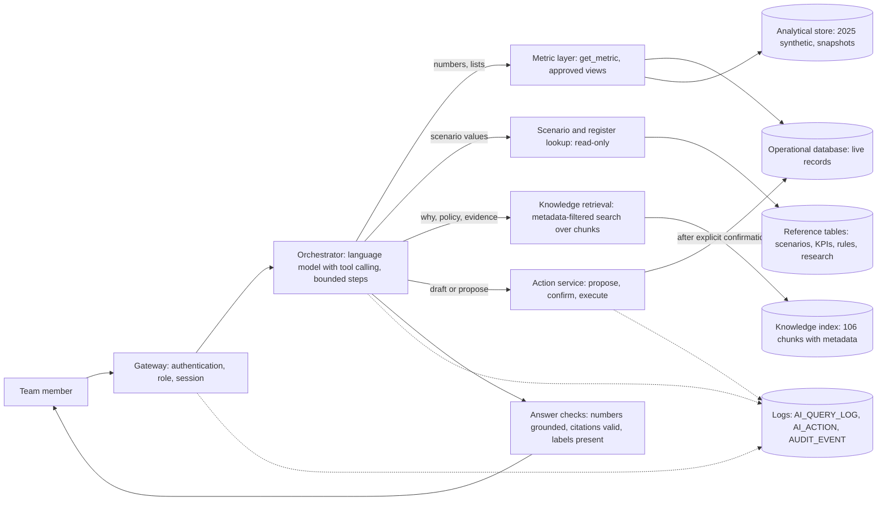

# AI knowledge architecture for the Growth Analyst

Phase 6 · version 1.0 · 2026-11-26 · **status: proposed** (logical architecture for Stage 8; names capabilities, not products).

The knowledge content, the routing rules and the permission model already exist as knowledge documents: KB-17 (query routing) and KB-18 (action permissions), both marked proposed. This document is the architecture around them: the components, how a question flows through them, what each store holds, and the controls that keep the AI from inventing numbers or acting without permission. The product choices for each component are compared in `technology_options_report.md` §4–5.

## 1. What the AI is for, and what it is not

The Growth Analyst answers questions about the sponsorship season, explains the strategy behind the numbers, and drafts or proposes actions. It is **not** a source of numbers. Every number it states comes from a tool call against the metric layer, the scenario catalogue or a register, and it cites that source. The evaluation bank in `07_AI_EVALUATION` (66 cases) defines the expected behaviour; its route mix shows the balance this architecture must serve:

| Route in the test bank | Tests | Share |
|---|---:|---:|
| Document retrieval only (`rag`) | 23 | 35% |
| Structured query only (`sql`) | 17 | 26% |
| Both (`hybrid`) | 17 | 26% |
| Actions (`action`) | 4 | 6% |
| Refusals (`refuse`) | 4 | 6% |
| Scenario lookup (`lookup`) | 1 | 2% |

Two thirds of the tests need structured data. Retrieval is necessary but it is not the core of the system.

## 2. Components

*Figure 1. Logical components. Solid arrows are calls; dotted arrows are logging. No component lets the language model write to the database directly.*

| Component | Responsibility | Holds or calls | Key control |
|---|---|---|---|
| Gateway | Authenticates the user, attaches role and edition, opens a session | Identity provider; `ROLE_ASSIGNMENT` | The AI inherits the user's permissions, never more |
| Orchestrator | Interprets the question, chooses tools, composes the answer | Language model with tool calling | Bounded loop (proposed: at most 6 tool calls per question); no tool can write except through the action service |
| Metric layer | Computes every KPI and metric with the approved definition, as of a date | `metric_dictionary.csv` (30 metrics, 21 with tested SQL); approved read-only views | The same code path serves the dashboard and the AI; returns value, numerator, denominator, `record_class`, `data_version`, query text |
| Scenario and register lookup | Returns approved scenario rows, KPI definitions, threshold rules, experiments, risks, assumptions | `SCENARIO_REFERENCE`, `KPI_DEFINITION`, `THRESHOLD_RULE`, `EXPERIMENT`, `MODEL_ASSUMPTION` | Read-only; scenario values are looked up, never recomputed (metric M-30) |
| Knowledge retrieval | Finds chunks that explain rationale, policy, evidence and limitations | `chunks.jsonl` / `KNOWLEDGE_CHUNK` with metadata | Filters on `decision_status` and `retrieval_rule` before ranking (section 4) |
| Action service | Turns an AI proposal into a reviewed write | `AI_ACTION`; the operational database | Propose → show exact payload → explicit confirmation by an authorised person → execute exactly the payload; forbidden actions cannot be proposed (KB-18) |
| Answer checks | Verifies the answer before it is shown | Tool results of this turn; chunk index | Every number in the answer must match a tool result or a cited chunk (section 6) |
| Logs | Records question, route, tool calls, citations, data version, answer, actions | `AI_QUERY_LOG`, `AI_ACTION`, `AUDIT_EVENT` | Append-only; used for evaluation and audit |

## 3. Routing

Routing follows KB-17 (proposed). The orchestrator decides the route from the question's intent; the table gives the decision rules and the test cases that check them.

| Question intent | Route | Tools | Must not | Example tests |
|---|---|---|---|---|
| How much, how many, what rate, which is highest, is X on track | Structured | `get_metric`; `run_readonly_sql` only when no metric exists (OD-09) | Take a number from a document | T-01, T-03, T-08, T-65 |
| Why, what does the policy say, what evidence supports, what are the limits | Retrieval | `search_knowledge` with metadata filters | Answer from memory without a chunk | T-07, T-19, T-35, T-39 |
| A number plus its explanation or implication | Hybrid | Metric first, then retrieval | Let the retrieved text override the computed number | T-06, T-12, T-22, T-27 |
| Approved scenario values and probabilities | Lookup | `get_scenario` | Recompute, scale or average scenarios | T-23, T-24 |
| Do something (task, log, campaign) | Action | `propose_action` → confirmation → `execute_action` | Write before confirmation; act beyond the user's role | T-47 to T-50 |
| Forbidden change (payments, targets, forecasts, deletes) | Refuse | None | Draft the forbidden change | T-59 to T-62 |
| Data that does not exist (2025 cash, outstanding, spend) | Structured, returns "not computable" | `get_metric` returns the metric's reason | Estimate or fill the gap | T-51 to T-54 |
| Old or contradictory figure in the question | Retrieval with history filter enabled | `search_knowledge(include_history=true)` | Treat the superseded figure as current | T-55 to T-58 |

**Where RAG adds value, and where it does not.** Retrieval earns its place for rationale, policy, evidence and limitations: text that is stable, written once and needs to be quoted with its source. It adds nothing and creates risk for anything that changes with records (cash, pipeline, tasks, KPI values): a document snapshot of a number is stale the moment a deal moves. Those questions go to the metric layer. This is why the knowledge base holds no live numbers and the metric dictionary holds no prose rationale.

## 4. Knowledge store and retrieval design

**What is stored.** 18 documents, 106 chunks, about 8,800 words (34–173 words per chunk, median 81). By a rough estimate of 1.3 tokens per word, the whole approved corpus is on the order of 11–12 thousand tokens. Each chunk carries: `chunk_id`, `doc_id`, title, section, `source_id`, `source_type`, `evidence_class`, `effective_date`, `version`, `decision_status`, `retrieval_rule`, `related_bet`, `related_kpi`, `citation_location` (`06_BUSINESS_KNOWLEDGE_BASE/chunk_index.csv`).

**The corpus is small enough that the retrieval method is a cost and simplicity choice, not a scale problem.** Three designs are viable (compared in `technology_options_report.md` §4):

1. Metadata-filtered full-text search (keyword ranking over chunks after filtering).
2. Hybrid search (full-text plus vector similarity, merged by rank).
3. No search: place every currently approved chunk in the model's context for each question, after filtering out history-only chunks.

**Filters applied before any ranking, whatever the design:**

| Filter | Rule |
|---|---|
| `retrieval_rule` | `contradiction_and_history_only` chunks (KB-15) are excluded unless the question cites an old figure or asks what changed; when included they are labelled as history and paired with the current value |
| `decision_status` | `approved` and `reference` by default; `proposed` included only with a "proposed, not approved" label; superseded content never appears outside KB-15 (checked in Phase 5) |
| `related_bet`, `related_kpi` | Optional narrowing when the question names a bet or KPI |
| `effective_date`, `version` | Only the latest version of a document is indexed; older versions are kept in version control, not in the index |

**Updating the knowledge base.** A document change bumps its `version` and `effective_date`; `build_knowledge_index.py` regenerates the index and fails if any chunk lacks metadata, a KPI link is broken or a cited source path is missing. A changed decision adds the old item to KB-15 with its replacement; it is never deleted.

## 5. The metric and data layer the AI uses

- **One definition per number.** `get_metric` executes the SQL stored in `METRIC_DEFINITION` (today `metric_dictionary.csv`) against class-filtered views. The dashboard calls the same function.
- **As-of semantics.** Every metric accepts `as_of`; versioned entities return the latest version before `as_of + 1 day`.
- **Record classes stay apart.** A metric over 2025 synthetic data and the same metric over live data are two calls with two results; the AI may compare them, but never adds them.
- **"Not computable" is an answer.** Eight metrics have no 2025 source (cash collected, collected ÷ signed, outstanding, advance within 7 days, premium signed pre-season, hours vs model, interested renewals, committed introductions). The tool returns the reason, and the AI must say so (test bank T-51 to T-54).
- **Ad-hoc SQL is a fallback, not a feature.** If allowed at all (OD-09), it runs read-only, against approved views only, with a row limit and a timeout, and the query is shown with the answer. It is never used for financial totals that have a metric.

## 6. Controls against invented numbers and unsafe actions

| Risk | Control | Where tested |
|---|---|---|
| Model does arithmetic on financial figures from text | Answer check: every number in the answer must appear in a tool result of this turn or in a cited chunk; otherwise the answer is blocked and regenerated with the missing tool call | Gate failure 6 in `scoring_rubric.md`; T-28 |
| Superseded strategy presented as current | Retrieval filters (section 4); KB-15 history-only rule; scoring gate 4 | T-55 to T-58 |
| Signed, collected and in-kind value confused | Metric outputs carry `value_nature` and record class; answer format requires the label; scoring gate 1 | T-01, T-23, T-25 |
| Research targets treated as pipeline | Prospect tools return `record_class = external_research`; pipeline metrics exclude research targets by construction | T-14, T-15, T-17 |
| AI writes without permission | Action service only; server-side permission check against the user's role; payload hash compared at execution; forbidden types not representable | T-47 to T-50, T-59 to T-62 |
| Prompt text inside records or documents tries to steer the AI | Retrieved text and record fields are passed as data; tools ignore instructions found in data; actions always need a human confirmation | Not yet in the bank: add adversarial cases in Stage 8 |
| Sensitive data sent to an external model provider | Tools return the minimum fields needed; contact personal data and bank references are not returned to the model unless the question needs them and the user's role allows it | Stage 8 review (OD-07, OD-28) |

## 7. Evaluation as a release gate

The 66-case bank is the acceptance test for any implementation. Proposed gates (from `scoring_rubric.md`, itself proposed): at least 90% of tests pass overall, and every Permissions, Action execution and Missing information test passes. The bank is regenerated with `build_test_bank.py` whenever the data changes, so expected values always match the database the assistant reads. Every `AI_QUERY_LOG` row with negative feedback becomes a candidate test case.

## 8. Decisions this architecture leaves open

Retrieval method and whether to embed at all (OD-05, OD-06); model provider (OD-07); orchestration framework versus direct tool calling (OD-08); whether the AI may run ad-hoc SQL (OD-09); approval of KB-17, KB-18 and the scoring rubric (OD-23). See `open_technical_decisions.md`.
