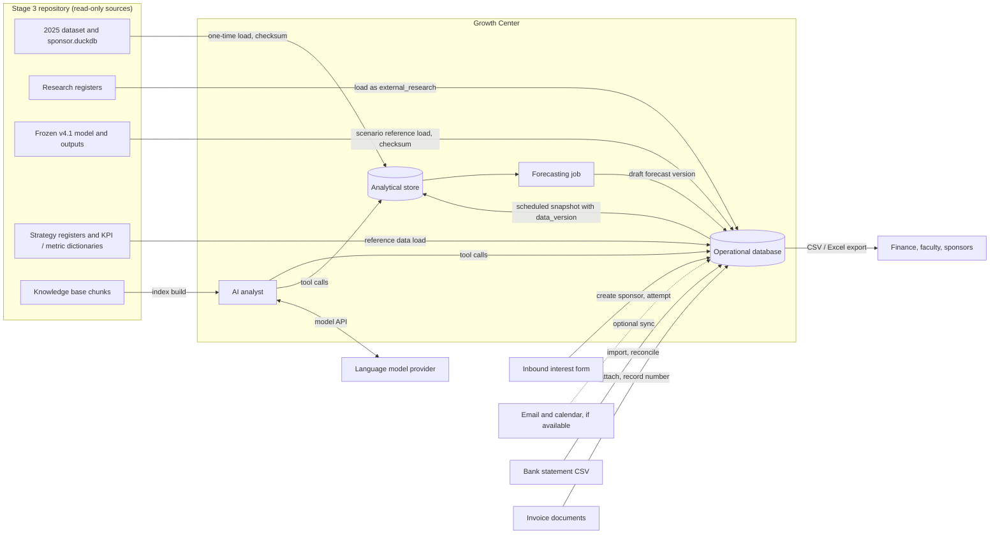

# Integration requirements

Phase 6 · version 1.0 · 2026-11-26 · **status: proposed**.

What has to flow into and out of the Growth Center, and what is unknown. The repository does not record which tools the festival team uses today (email provider, calendar, messaging, accounting, bank) [U]. Every integration is therefore specified as an adapter that the first release can replace with manual entry or a file import, so no workflow depends on an integration that may not exist.

## 1. Integration map

*Figure 1. Data flows. Solid arrows are needed in some form for the first release; dotted arrows are optional.*

## 2. Inbound integrations

| ID | Source | Data | Direction and frequency | First-release method (proposed) | Later options | Record class | Open questions |
|---|---|---|---|---|---|---|---|
| IN-01 | 2025 assignment dataset (`sponsor.duckdb`, original workbooks) | Brands, contacts, campaigns, interactions, qualification and stage history, targets | One-time load into the analytical store; optionally into the operational database as reference rows | Read directly from the existing DuckDB file; record SHA-256 (`42af2e03…`) in `IMPORT_BATCH` | None needed | historical_synthetic | Whether the app needs 2025 rows at all, or only the analytical store (OD-02) |
| IN-02 | Research registers (`03_MARKET_RESEARCH/`) | Prospects, benchmarks, sources | Load once; reload when research is updated | CSV import with validation (required fields, SRC-ids resolve) | Research entry form in the app | external_research | Who maintains research during the season |
| IN-03 | Approved scenarios and model outputs (`04_FINANCIAL_MODELLING/`) | SC-01…SC-14 with status; checksums | Load once per approved decision | Migration script that verifies `output_checksums.csv` before insert | None | model_output | — |
| IN-04 | Strategy reference data (`05_STRATEGY/`, metric dictionary) | Bets, KPIs, metrics with SQL, threshold rules, experiments, targets | Load on approval of a new version | Migration with version numbers | Admin screen with approval workflow | operating_plan | Who approves new versions (OD-23) |
| IN-05 | Knowledge base (`06_BUSINESS_KNOWLEDGE_BASE/`) | 106 chunks with metadata | On every document change | `build_knowledge_index.py` output loaded into the retrieval store | Embeddings generated at load if vector retrieval is chosen (OD-06) | per chunk | — |
| IN-06 | Inbound partner interest form (2025 campaign SC04) | Company, contact, interest | Continuous | Web form writing a sponsor (prospect), contact and inbound attempt; duplicate check | Existing form tool posting to the app | live | Which form tool the festival uses today [U] |
| IN-07 | Email (outreach, proposals) | Sent and received messages with sponsors | Continuous | Manual logging of interactions; proposal document attached | Mailbox sync that logs interactions automatically | live | Provider [U]; consent and privacy of syncing personal mailboxes (OD-13, OD-28) |
| IN-08 | Calendar | Meetings booked and held | Continuous | Manual meeting records | Calendar sync for meetings with sponsor contacts | live | Provider [U] (OD-13) |
| IN-09 | Messaging apps (e.g. WhatsApp) | Conversations | Continuous | Manual interaction log with a one-line summary | No integration recommended (personal accounts) | live | Whether the team uses it [U] |
| IN-10 | Bank account of the festival | Credits from sponsors | Daily to weekly | Finance enters receipts with bank reference; optional bank-statement CSV import that proposes matches for finance to confirm | Bank API if the account's bank offers one | live | Which account, who has access, export format [U] (OD-16) |
| IN-11 | Invoices | Invoice number, amount, date, PDF | On signing and at T−7 | Record invoice issued by whoever issues it today; attach PDF | Generate invoices in the app if the festival may issue them | live | Issuer and GST treatment [U] (OD-15) |
| IN-12 | Hours and staffing | Hours by task type and bet; weekly plan | Weekly | In-app time log; staffing plan imported from `resource_allocation.xlsx` | — | live | Willingness of student volunteers to log hours (adoption risk) |
| IN-13 | Identity | User accounts | On joining and leaving | Managed authentication with email login | Institutional single sign-on if the institution provides one | live | Institution identity provider [U] (OD-04) |

## 3. Outbound integrations

| ID | Target | Data | Method (proposed) | Control |
|---|---|---|---|---|
| OUT-01 | Analytical store | Nightly (or on-demand) snapshot of operational tables with `data_version` | Read-only extract (database attach or export to Parquet) | The analytical store never writes back to operational tables |
| OUT-02 | Forecasting job | Observed values for a re-forecast | The frozen v4.1 code run in its reproducibility environment against a snapshot | Output written as a draft `FORECAST_VERSION`; published only after review (OD-12) |
| OUT-03 | Language model provider | Question, tool results, retrieved chunks | Provider API over TLS | Minimum necessary fields; provider's data-retention and training terms checked before use (OD-07) |
| OUT-04 | Reports | CSV or Excel exports of lists and KPI views | Export from any table view | Exports logged; restricted fields excluded unless the role allows them |
| OUT-05 | Sponsors | Proposals, invoices, reminders | Drafted in the app, sent by a person from their own tools | Neither the product nor the AI sends external messages in the first release (KB-18; OD-13) |

## 4. Data validation at every inbound boundary

1. Schema checks: required fields, types, enumerations (stage, event type, consideration type, record class).
2. Referential checks: every foreign key resolves; no orphan rows (the 2025 referential audit checks R1–R14 in `audit.results` are the pattern).
3. Business rules: INV-01–INV-12 in `conceptual_data_model.md` §5 (e.g. receipts only `live`, exclusivity not overlapping).
4. Duplicate detection: normalised sponsor names; `(attempt_id, event_type, occurred_at)` for interactions; bank reference for receipts.
5. Provenance: every batch writes an `IMPORT_BATCH` row with source file, checksum, row count and validation status; failed batches load nothing.

## 5. What the first release can do without any external integration

Every workflow in `architecture_requirements.md` can run on manual entry plus three file imports (research registers, strategy reference data, bank-statement CSV for reconciliation). Integrations IN-07 to IN-10 reduce typing but are not prerequisites, which keeps the first release independent of tools the repository cannot confirm exist.
